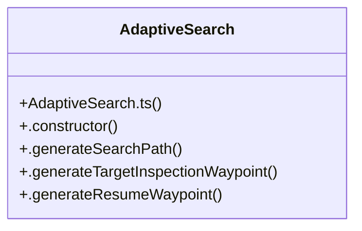

# Adaptivesearch Subsystem

> 6 nodes · cohesion 0.33

## Key Concepts

- [AdaptiveSearch](file:///C:/Antigravityyyyy/last%20drone/skycon/frontend/src/services/searchEngine/AdaptiveSearch.ts#L14) (5 connections)
- [.constructor()](file:///C:/Antigravityyyyy/last%20drone/skycon/frontend/src/services/searchEngine/AdaptiveSearch.ts#L21) (1 connections)
- [.generateResumeWaypoint()](file:///C:/Antigravityyyyy/last%20drone/skycon/frontend/src/services/searchEngine/AdaptiveSearch.ts#L83) (1 connections)
- [.generateSearchPath()](file:///C:/Antigravityyyyy/last%20drone/skycon/frontend/src/services/searchEngine/AdaptiveSearch.ts#L32) (1 connections)
- [.generateTargetInspectionWaypoint()](file:///C:/Antigravityyyyy/last%20drone/skycon/frontend/src/services/searchEngine/AdaptiveSearch.ts#L64) (1 connections)
- [AdaptiveSearch.ts](file:///C:/Antigravityyyyy/last%20drone/skycon/frontend/src/services/searchEngine/AdaptiveSearch.ts#L1) (1 connections)

## Class Diagram

## Relationships

- No strong cross-community connections detected

## Source Files

- [skycon\frontend\src\services\searchEngine\AdaptiveSearch.ts](file:///C:/Antigravityyyyy/last%20drone/skycon/frontend/src/services/searchEngine/AdaptiveSearch.ts)

## Audit Trail

- EXTRACTED: 10 (100%)
- INFERRED: 0 (0%)
- AMBIGUOUS: 0 (0%)

---

*Part of the graphify knowledge wiki. See [[index]] to navigate.*