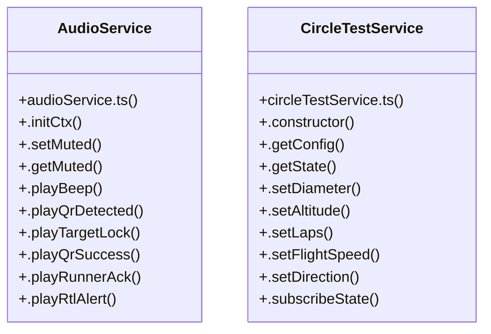

# Audio & Haptic Alert Service

> 102 nodes · cohesion 0.03

## Key Concepts

- [.playBeep()](file:///C:/Antigravityyyyy/last%20drone/skycon/frontend/src/services/audioService.ts#L28) (80 connections)
- [DashboardPage.tsx](file:///C:/Antigravityyyyy/last%20drone/skycon/frontend/src/features/dashboard/DashboardPage.tsx#L1) (35 connections)
- [CircleTestService](file:///C:/Antigravityyyyy/last%20drone/skycon/frontend/src/services/circleTestService.ts#L14) (26 connections)
- [FlightParams.tsx](file:///C:/Antigravityyyyy/last%20drone/skycon/frontend/src/features/dashboard/FlightParams.tsx#L1) (22 connections)
- [.executeMission()](file:///C:/Antigravityyyyy/last%20drone/skycon/frontend/src/services/circleTestService.ts#L350) (15 connections)
- [.notifyState()](file:///C:/Antigravityyyyy/last%20drone/skycon/frontend/src/services/circleTestService.ts#L176) (15 connections)
- [AudioService](file:///C:/Antigravityyyyy/last%20drone/skycon/frontend/src/services/audioService.ts#L3) (13 connections)
- [.setAltitude()](file:///C:/Antigravityyyyy/last%20drone/skycon/frontend/src/services/circleTestService.ts#L124) (11 connections)
- [showNotification()](file:///C:/Antigravityyyyy/last%20drone/skycon/frontend/src/features/dashboard/DashboardPage.tsx#L126) (10 connections)
- [.playRtlAlert()](file:///C:/Antigravityyyyy/last%20drone/skycon/frontend/src/services/audioService.ts#L76) (8 connections)
- [.abort()](file:///C:/Antigravityyyyy/last%20drone/skycon/frontend/src/services/circleTestService.ts#L799) (8 connections)
- [.initiateClimb()](file:///C:/Antigravityyyyy/last%20drone/skycon/frontend/src/services/circleTestService.ts#L517) (7 connections)
- [.playTargetLock()](file:///C:/Antigravityyyyy/last%20drone/skycon/frontend/src/services/audioService.ts#L57) (6 connections)
- [handleEmergencyRTL()](file:///C:/Antigravityyyyy/last%20drone/skycon/frontend/src/features/dashboard/DashboardPage.tsx#L344) (6 connections)
- [.clearAllTimers()](file:///C:/Antigravityyyyy/last%20drone/skycon/frontend/src/services/circleTestService.ts#L821) (5 connections)
- [.disarmAndComplete()](file:///C:/Antigravityyyyy/last%20drone/skycon/frontend/src/services/circleTestService.ts#L774) (5 connections)
- [.startCircularOrbit()](file:///C:/Antigravityyyyy/last%20drone/skycon/frontend/src/services/circleTestService.ts#L604) (5 connections)
- [confirmEmergencyRTL()](file:///C:/Antigravityyyyy/last%20drone/skycon/frontend/src/features/dashboard/DashboardPage.tsx#L375) (5 connections)
- [Header.tsx](file:///C:/Antigravityyyyy/last%20drone/skycon/frontend/src/components/common/Header.tsx#L1) (5 connections)
- [.playQrSuccess()](file:///C:/Antigravityyyyy/last%20drone/skycon/frontend/src/services/audioService.ts#L63) (4 connections)
- [.beginDescentAndLand()](file:///C:/Antigravityyyyy/last%20drone/skycon/frontend/src/services/circleTestService.ts#L742) (4 connections)
- [.isValidCoordinate()](file:///C:/Antigravityyyyy/last%20drone/skycon/frontend/src/services/circleTestService.ts#L187) (4 connections)
- [.resetState()](file:///C:/Antigravityyyyy/last%20drone/skycon/frontend/src/services/circleTestService.ts#L838) (4 connections)
- [.returnToCenterTakeoffPoint()](file:///C:/Antigravityyyyy/last%20drone/skycon/frontend/src/services/circleTestService.ts#L706) (4 connections)
- [handleToggleRC()](file:///C:/Antigravityyyyy/last%20drone/skycon/frontend/src/features/dashboard/DashboardPage.tsx#L163) (4 connections)
- *... and 77 more nodes in this community*

## Class Diagram

## Relationships

- No strong cross-community connections detected

## Source Files

- [skycon\frontend\src\components\GroundStation\GoogleMapGroundStation.tsx](file:///C:/Antigravityyyyy/last%20drone/skycon/frontend/src/components/GroundStation/GoogleMapGroundStation.tsx)
- [skycon\frontend\src\components\Mission\AutonomousMissionConfigModal.tsx](file:///C:/Antigravityyyyy/last%20drone/skycon/frontend/src/components/Mission/AutonomousMissionConfigModal.tsx)
- [skycon\frontend\src\components\common\Header.tsx](file:///C:/Antigravityyyyy/last%20drone/skycon/frontend/src/components/common/Header.tsx)
- [skycon\frontend\src\features\dashboard\DashboardPage.tsx](file:///C:/Antigravityyyyy/last%20drone/skycon/frontend/src/features/dashboard/DashboardPage.tsx)
- [skycon\frontend\src\features\dashboard\FlightParams.tsx](file:///C:/Antigravityyyyy/last%20drone/skycon/frontend/src/features/dashboard/FlightParams.tsx)
- [skycon\frontend\src\features\dashboard\MapPanel.tsx](file:///C:/Antigravityyyyy/last%20drone/skycon/frontend/src/features/dashboard/MapPanel.tsx)
- [skycon\frontend\src\services\audioService.ts](file:///C:/Antigravityyyyy/last%20drone/skycon/frontend/src/services/audioService.ts)
- [skycon\frontend\src\services\circleTestService.ts](file:///C:/Antigravityyyyy/last%20drone/skycon/frontend/src/services/circleTestService.ts)

## Audit Trail

- EXTRACTED: 278 (65%)
- INFERRED: 150 (35%)
- AMBIGUOUS: 0 (0%)

---

*Part of the graphify knowledge wiki. See [[index]] to navigate.*