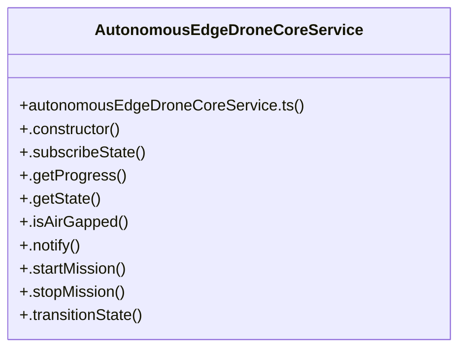

# Autonomous Edge Core Servoin

> 66 nodes · cohesion 0.05

## Key Concepts

- [DroneDashboard.tsx](file:///C:/Antigravityyyyy/last%20drone/skycon/frontend/src/components/Drone/DroneDashboard.tsx#L1) (27 connections)
- [AutonomousEdgeDroneCoreService](file:///C:/Antigravityyyyy/last%20drone/skycon/frontend/src/services/autonomousEdgeDroneCoreService.ts#L62) (25 connections)
- [runEdgeTestSuite()](file:///C:/Antigravityyyyy/last%20drone/skycon/tests/test-autonomous-edge-drone-core.ts#L64) (17 connections)
- [.setDroneCoreStatus()](file:///C:/Antigravityyyyy/last%20drone/skycon/frontend/src/services/reconDetectionService.ts#L699) (16 connections)
- [test-autonomous-edge-drone-core.ts](file:///C:/Antigravityyyyy/last%20drone/skycon/tests/test-autonomous-edge-drone-core.ts#L1) (10 connections)
- [.handleSuccessfulDecode()](file:///C:/Antigravityyyyy/last%20drone/skycon/frontend/src/services/autonomousEdgeDroneCoreService.ts#L576) (9 connections)
- [.startMission()](file:///C:/Antigravityyyyy/last%20drone/skycon/frontend/src/services/autonomousEdgeDroneCoreService.ts#L162) (9 connections)
- [.stepApproachingState()](file:///C:/Antigravityyyyy/last%20drone/skycon/frontend/src/services/autonomousEdgeDroneCoreService.ts#L474) (9 connections)
- [.stepDecodingState()](file:///C:/Antigravityyyyy/last%20drone/skycon/frontend/src/services/autonomousEdgeDroneCoreService.ts#L516) (9 connections)
- [.transitionState()](file:///C:/Antigravityyyyy/last%20drone/skycon/frontend/src/services/autonomousEdgeDroneCoreService.ts#L232) (9 connections)
- [.handleCandidateIdentified()](file:///C:/Antigravityyyyy/last%20drone/skycon/frontend/src/services/autonomousEdgeDroneCoreService.ts#L397) (7 connections)
- [.stepTargetDetectedState()](file:///C:/Antigravityyyyy/last%20drone/skycon/frontend/src/services/autonomousEdgeDroneCoreService.ts#L442) (7 connections)
- [.stepSearchingState()](file:///C:/Antigravityyyyy/last%20drone/skycon/frontend/src/services/autonomousEdgeDroneCoreService.ts#L370) (6 connections)
- [.stopMission()](file:///C:/Antigravityyyyy/last%20drone/skycon/frontend/src/services/autonomousEdgeDroneCoreService.ts#L209) (6 connections)
- [.executeActiveStateStep()](file:///C:/Antigravityyyyy/last%20drone/skycon/frontend/src/services/autonomousEdgeDroneCoreService.ts#L345) (5 connections)
- [handleToggleCamera()](file:///C:/Antigravityyyyy/last%20drone/skycon/frontend/src/components/Drone/DroneDashboard.tsx#L207) (5 connections)
- [startCamera()](file:///C:/Antigravityyyyy/last%20drone/skycon/frontend/src/components/Drone/DroneDashboard.tsx#L110) (5 connections)
- [.applyZoomToHardwareOrCanvas()](file:///C:/Antigravityyyyy/last%20drone/skycon/frontend/src/services/autonomousEdgeDroneCoreService.ts#L305) (4 connections)
- [.attemptMultiPassDecode()](file:///C:/Antigravityyyyy/last%20drone/skycon/frontend/src/services/autonomousEdgeDroneCoreService.ts#L544) (4 connections)
- [.captureActiveVideoFrame()](file:///C:/Antigravityyyyy/last%20drone/skycon/frontend/src/services/autonomousEdgeDroneCoreService.ts#L711) (4 connections)
- [.getProgress()](file:///C:/Antigravityyyyy/last%20drone/skycon/frontend/src/services/autonomousEdgeDroneCoreService.ts#L116) (4 connections)
- [handleToggleEdgeMission()](file:///C:/Antigravityyyyy/last%20drone/skycon/frontend/src/components/Drone/DroneDashboard.tsx#L240) (4 connections)
- [.calculateGeodesicGroundOffset()](file:///C:/Antigravityyyyy/last%20drone/skycon/frontend/src/services/autonomousEdgeDroneCoreService.ts#L643) (3 connections)
- [.notify()](file:///C:/Antigravityyyyy/last%20drone/skycon/frontend/src/services/autonomousEdgeDroneCoreService.ts#L147) (3 connections)
- [handleRestartCamera()](file:///C:/Antigravityyyyy/last%20drone/skycon/frontend/src/components/Drone/DroneDashboard.tsx#L230) (3 connections)
- *... and 41 more nodes in this community*

## Class Diagram

## Relationships

- No strong cross-community connections detected

## Source Files

- [skycon\frontend\src\components\Drone\DroneDashboard.tsx](file:///C:/Antigravityyyyy/last%20drone/skycon/frontend/src/components/Drone/DroneDashboard.tsx)
- [skycon\frontend\src\services\autonomousEdgeDroneCoreService.ts](file:///C:/Antigravityyyyy/last%20drone/skycon/frontend/src/services/autonomousEdgeDroneCoreService.ts)
- [skycon\frontend\src\services\reconDetectionService.ts](file:///C:/Antigravityyyyy/last%20drone/skycon/frontend/src/services/reconDetectionService.ts)
- [skycon\tests\test-autonomous-edge-drone-core.ts](file:///C:/Antigravityyyyy/last%20drone/skycon/tests/test-autonomous-edge-drone-core.ts)

## Audit Trail

- EXTRACTED: 197 (76%)
- INFERRED: 61 (24%)
- AMBIGUOUS: 0 (0%)

---

*Part of the graphify knowledge wiki. See [[index]] to navigate.*