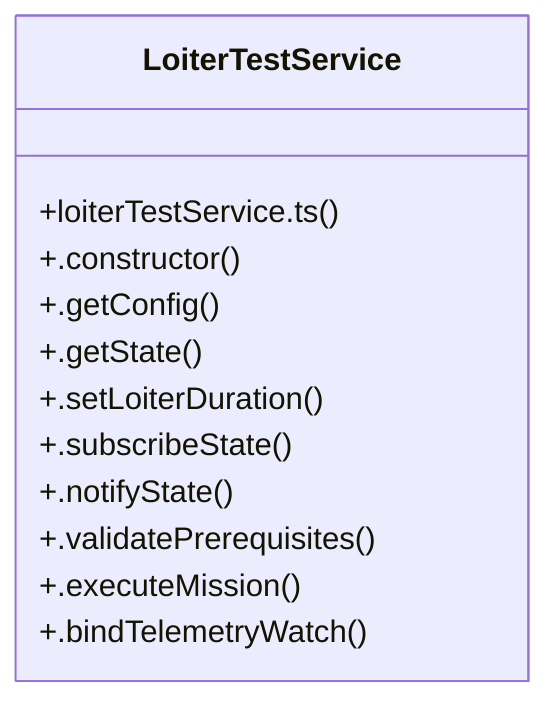

# Autonomous Mission Controls

> 133 nodes · cohesion 0.02

## Key Concepts

- [AutonomousMissionConfigModal.tsx](file:///C:/Antigravityyyyy/last%20drone/skycon/frontend/src/components/Mission/AutonomousMissionConfigModal.tsx#L1) (52 connections)
- [MissionConfigurationCard.tsx](file:///C:/Antigravityyyyy/last%20drone/skycon/frontend/src/components/GroundStation/MissionConfigurationCard.tsx#L1) (27 connections)
- [LoiterTestService](file:///C:/Antigravityyyyy/last%20drone/skycon/frontend/src/services/loiterTestService.ts#L15) (17 connections)
- [CircleTestMissionModal.tsx](file:///C:/Antigravityyyyy/last%20drone/skycon/frontend/src/components/Mission/CircleTestMissionModal.tsx#L1) (16 connections)
- [.executeMission()](file:///C:/Antigravityyyyy/last%20drone/skycon/frontend/src/services/loiterTestService.ts#L179) (15 connections)
- [LoiterTestMissionModal.tsx](file:///C:/Antigravityyyyy/last%20drone/skycon/frontend/src/components/Mission/LoiterTestMissionModal.tsx#L1) (14 connections)
- [.abort()](file:///C:/Antigravityyyyy/last%20drone/skycon/frontend/src/services/loiterTestService.ts#L416) (13 connections)
- [.setConfig()](file:///C:/Antigravityyyyy/last%20drone/skycon/frontend/src/services/transports/Esp32WebSocketTransport.ts#L396) (12 connections)
- [.notifyState()](file:///C:/Antigravityyyyy/last%20drone/skycon/frontend/src/services/loiterTestService.ts#L90) (9 connections)
- [.resetState()](file:///C:/Antigravityyyyy/last%20drone/skycon/frontend/src/services/loiterTestService.ts#L452) (9 connections)
- [.getConfig()](file:///C:/Antigravityyyyy/last%20drone/skycon/frontend/src/services/searchEngine/SearchEngine.ts#L140) (8 connections)
- [.setDiameter()](file:///C:/Antigravityyyyy/last%20drone/skycon/frontend/src/services/circleTestService.ts#L110) (7 connections)
- [.setLaps()](file:///C:/Antigravityyyyy/last%20drone/skycon/frontend/src/services/circleTestService.ts#L137) (7 connections)
- [handleCircleToggle()](file:///C:/Antigravityyyyy/last%20drone/skycon/frontend/src/components/GroundStation/MissionConfigurationCard.tsx#L109) (6 connections)
- [.setDirection()](file:///C:/Antigravityyyyy/last%20drone/skycon/frontend/src/services/circleTestService.ts#L158) (5 connections)
- [.setFlightSpeed()](file:///C:/Antigravityyyyy/last%20drone/skycon/frontend/src/services/circleTestService.ts#L150) (5 connections)
- [.clearAllTimers()](file:///C:/Antigravityyyyy/last%20drone/skycon/frontend/src/services/loiterTestService.ts#L437) (5 connections)
- [.disarmAndComplete()](file:///C:/Antigravityyyyy/last%20drone/skycon/frontend/src/services/loiterTestService.ts#L392) (5 connections)
- [.setLoiterDuration()](file:///C:/Antigravityyyyy/last%20drone/skycon/frontend/src/services/loiterTestService.ts#L70) (5 connections)
- [handleAltitudeChange()](file:///C:/Antigravityyyyy/last%20drone/skycon/frontend/src/components/Mission/CircleTestMissionModal.tsx#L57) (4 connections)
- [handleDiameterChange()](file:///C:/Antigravityyyyy/last%20drone/skycon/frontend/src/components/Mission/CircleTestMissionModal.tsx#L51) (4 connections)
- [handleDirectionChange()](file:///C:/Antigravityyyyy/last%20drone/skycon/frontend/src/components/Mission/CircleTestMissionModal.tsx#L69) (4 connections)
- [handleLapsChange()](file:///C:/Antigravityyyyy/last%20drone/skycon/frontend/src/components/Mission/CircleTestMissionModal.tsx#L63) (4 connections)
- [handleDurationSelect()](file:///C:/Antigravityyyyy/last%20drone/skycon/frontend/src/components/Mission/LoiterTestMissionModal.tsx#L73) (4 connections)
- [.beginDescentAndLand()](file:///C:/Antigravityyyyy/last%20drone/skycon/frontend/src/services/loiterTestService.ts#L359) (4 connections)
- *... and 108 more nodes in this community*

## Class Diagram

## Relationships

- No strong cross-community connections detected

## Source Files

- [skycon\frontend\src\components\GroundStation\MissionConfigurationCard.tsx](file:///C:/Antigravityyyyy/last%20drone/skycon/frontend/src/components/GroundStation/MissionConfigurationCard.tsx)
- [skycon\frontend\src\components\Mission\AutonomousMissionConfigModal.tsx](file:///C:/Antigravityyyyy/last%20drone/skycon/frontend/src/components/Mission/AutonomousMissionConfigModal.tsx)
- [skycon\frontend\src\components\Mission\CircleTestMissionModal.tsx](file:///C:/Antigravityyyyy/last%20drone/skycon/frontend/src/components/Mission/CircleTestMissionModal.tsx)
- [skycon\frontend\src\components\Mission\CircleTestPanel.tsx](file:///C:/Antigravityyyyy/last%20drone/skycon/frontend/src/components/Mission/CircleTestPanel.tsx)
- [skycon\frontend\src\components\Mission\LoiterTestMissionModal.tsx](file:///C:/Antigravityyyyy/last%20drone/skycon/frontend/src/components/Mission/LoiterTestMissionModal.tsx)
- [skycon\frontend\src\services\circleTestService.ts](file:///C:/Antigravityyyyy/last%20drone/skycon/frontend/src/services/circleTestService.ts)
- [skycon\frontend\src\services\customRouteService.ts](file:///C:/Antigravityyyyy/last%20drone/skycon/frontend/src/services/customRouteService.ts)
- [skycon\frontend\src\services\loiterTestService.ts](file:///C:/Antigravityyyyy/last%20drone/skycon/frontend/src/services/loiterTestService.ts)
- [skycon\frontend\src\services\searchEngine\SearchEngine.ts](file:///C:/Antigravityyyyy/last%20drone/skycon/frontend/src/services/searchEngine/SearchEngine.ts)
- [skycon\frontend\src\services\transports\Esp32WebSocketTransport.ts](file:///C:/Antigravityyyyy/last%20drone/skycon/frontend/src/services/transports/Esp32WebSocketTransport.ts)

## Audit Trail

- EXTRACTED: 299 (73%)
- INFERRED: 113 (27%)
- AMBIGUOUS: 0 (0%)

---

*Part of the graphify knowledge wiki. See [[index]] to navigate.*