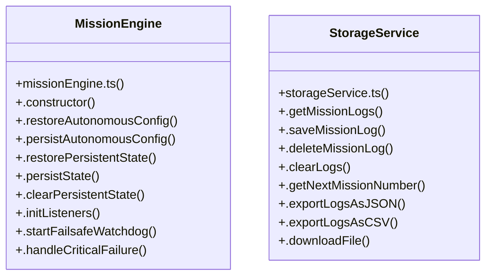

# Autonomous Mission Engine Li

> 101 nodes · cohesion 0.04

## Key Concepts

- [MissionEngine](file:///C:/Antigravityyyyy/last%20drone/skycon/frontend/src/services/missionEngine.ts#L71) (51 connections)
- [map](file:///C:/Antigravityyyyy/last%20drone/skycon/frontend/src/features/dashboard/MapPanel.tsx#L226) (25 connections)
- [.transitionTo()](file:///C:/Antigravityyyyy/last%20drone/skycon/frontend/src/services/missionEngine.ts#L1280) (18 connections)
- [.startMission()](file:///C:/Antigravityyyyy/last%20drone/skycon/frontend/src/services/missionEngine.ts#L917) (16 connections)
- [.triggerHaptic()](file:///C:/Antigravityyyyy/last%20drone/skycon/frontend/src/services/audioService.ts#L99) (15 connections)
- [.triggerEmergencyRTL()](file:///C:/Antigravityyyyy/last%20drone/skycon/frontend/src/services/missionEngine.ts#L1126) (15 connections)
- [.getHomePoint()](file:///C:/Antigravityyyyy/last%20drone/skycon/frontend/src/services/mavlinkService.ts#L698) (14 connections)
- [.updateSearchAltitude()](file:///C:/Antigravityyyyy/last%20drone/skycon/frontend/src/services/missionEngine.ts#L708) (12 connections)
- [.persistState()](file:///C:/Antigravityyyyy/last%20drone/skycon/frontend/src/services/missionEngine.ts#L224) (11 connections)
- [.switchToAutonomousControl()](file:///C:/Antigravityyyyy/last%20drone/skycon/frontend/src/services/missionEngine.ts#L577) (11 connections)
- [runTests()](file:///C:/Antigravityyyyy/last%20drone/skycon/tests/test-mission-fixes.ts#L24) (11 connections)
- [.finalizeMission()](file:///C:/Antigravityyyyy/last%20drone/skycon/frontend/src/services/missionEngine.ts#L1196) (10 connections)
- [.setHomePoint()](file:///C:/Antigravityyyyy/last%20drone/skycon/frontend/src/services/missionEngine.ts#L880) (10 connections)
- [.switchToManualControl()](file:///C:/Antigravityyyyy/last%20drone/skycon/frontend/src/services/missionEngine.ts#L543) (9 connections)
- [StorageService](file:///C:/Antigravityyyyy/last%20drone/skycon/frontend/src/services/storageService.ts#L6) (9 connections)
- [.notifyAuthority()](file:///C:/Antigravityyyyy/last%20drone/skycon/frontend/src/services/missionEngine.ts#L532) (8 connections)
- [.notifyState()](file:///C:/Antigravityyyyy/last%20drone/skycon/frontend/src/services/missionEngine.ts#L1286) (8 connections)
- [.validateMission()](file:///C:/Antigravityyyyy/last%20drone/skycon/frontend/src/services/missionEngine.ts#L745) (8 connections)
- [.handleCriticalFailure()](file:///C:/Antigravityyyyy/last%20drone/skycon/frontend/src/services/missionEngine.ts#L497) (7 connections)
- [.getMissionLogs()](file:///C:/Antigravityyyyy/last%20drone/skycon/frontend/src/services/storageService.ts#L7) (7 connections)
- [.validateRoute()](file:///C:/Antigravityyyyy/last%20drone/skycon/frontend/src/services/customRouteService.ts#L435) (6 connections)
- [handleSetHomeToDevice()](file:///C:/Antigravityyyyy/last%20drone/skycon/frontend/src/features/dashboard/MapPanel.tsx#L1094) (6 connections)
- [.handleRunnerAckReceived()](file:///C:/Antigravityyyyy/last%20drone/skycon/frontend/src/services/missionEngine.ts#L1079) (6 connections)
- [.onFcMotorsStartedConfirmed()](file:///C:/Antigravityyyyy/last%20drone/skycon/frontend/src/services/missionEngine.ts#L988) (6 connections)
- [missionEngine.ts](file:///C:/Antigravityyyyy/last%20drone/skycon/frontend/src/services/missionEngine.ts#L1) (6 connections)
- *... and 76 more nodes in this community*

## Class Diagram

## Relationships

- No strong cross-community connections detected

## Source Files

- [skycon\PROJECT_KNOWLEDGE_BASE.md](file:///C:/Antigravityyyyy/last%20drone/skycon/PROJECT_KNOWLEDGE_BASE.md)
- [skycon\frontend\src\App.tsx](file:///C:/Antigravityyyyy/last%20drone/skycon/frontend/src/App.tsx)
- [skycon\frontend\src\components\GroundStation\CompactHomePointCard.tsx](file:///C:/Antigravityyyyy/last%20drone/skycon/frontend/src/components/GroundStation/CompactHomePointCard.tsx)
- [skycon\frontend\src\components\History\MissionHistoryModal.tsx](file:///C:/Antigravityyyyy/last%20drone/skycon/frontend/src/components/History/MissionHistoryModal.tsx)
- [skycon\frontend\src\components\Mission\AutonomousMissionConfigModal.tsx](file:///C:/Antigravityyyyy/last%20drone/skycon/frontend/src/components/Mission/AutonomousMissionConfigModal.tsx)
- [skycon\frontend\src\components\Mission\AutonomousMissionStatusBar.tsx](file:///C:/Antigravityyyyy/last%20drone/skycon/frontend/src/components/Mission/AutonomousMissionStatusBar.tsx)
- [skycon\frontend\src\components\ModeSelector.tsx](file:///C:/Antigravityyyyy/last%20drone/skycon/frontend/src/components/ModeSelector.tsx)
- [skycon\frontend\src\components\common\MissionTimer.tsx](file:///C:/Antigravityyyyy/last%20drone/skycon/frontend/src/components/common/MissionTimer.tsx)
- [skycon\frontend\src\components\common\ModeSelectorBar.tsx](file:///C:/Antigravityyyyy/last%20drone/skycon/frontend/src/components/common/ModeSelectorBar.tsx)
- [skycon\frontend\src\features\dashboard\DashboardPage.tsx](file:///C:/Antigravityyyyy/last%20drone/skycon/frontend/src/features/dashboard/DashboardPage.tsx)
- [skycon\frontend\src\features\dashboard\MapPanel.tsx](file:///C:/Antigravityyyyy/last%20drone/skycon/frontend/src/features/dashboard/MapPanel.tsx)
- [skycon\frontend\src\features\dashboard\Sidebar.tsx](file:///C:/Antigravityyyyy/last%20drone/skycon/frontend/src/features/dashboard/Sidebar.tsx)
- [skycon\frontend\src\services\audioService.ts](file:///C:/Antigravityyyyy/last%20drone/skycon/frontend/src/services/audioService.ts)
- [skycon\frontend\src\services\customRouteService.ts](file:///C:/Antigravityyyyy/last%20drone/skycon/frontend/src/services/customRouteService.ts)
- [skycon\frontend\src\services\mavlinkService.ts](file:///C:/Antigravityyyyy/last%20drone/skycon/frontend/src/services/mavlinkService.ts)
- [skycon\frontend\src\services\missionEngine.ts](file:///C:/Antigravityyyyy/last%20drone/skycon/frontend/src/services/missionEngine.ts)
- [skycon\frontend\src\services\searchEngine\SearchEngine.ts](file:///C:/Antigravityyyyy/last%20drone/skycon/frontend/src/services/searchEngine/SearchEngine.ts)
- [skycon\frontend\src\services\storageService.ts](file:///C:/Antigravityyyyy/last%20drone/skycon/frontend/src/services/storageService.ts)
- [skycon\tests\test-mission-fixes.ts](file:///C:/Antigravityyyyy/last%20drone/skycon/tests/test-mission-fixes.ts)

## Audit Trail

- EXTRACTED: 309 (60%)
- INFERRED: 207 (40%)
- AMBIGUOUS: 0 (0%)

---

*Part of the graphify knowledge wiki. See [[index]] to navigate.*