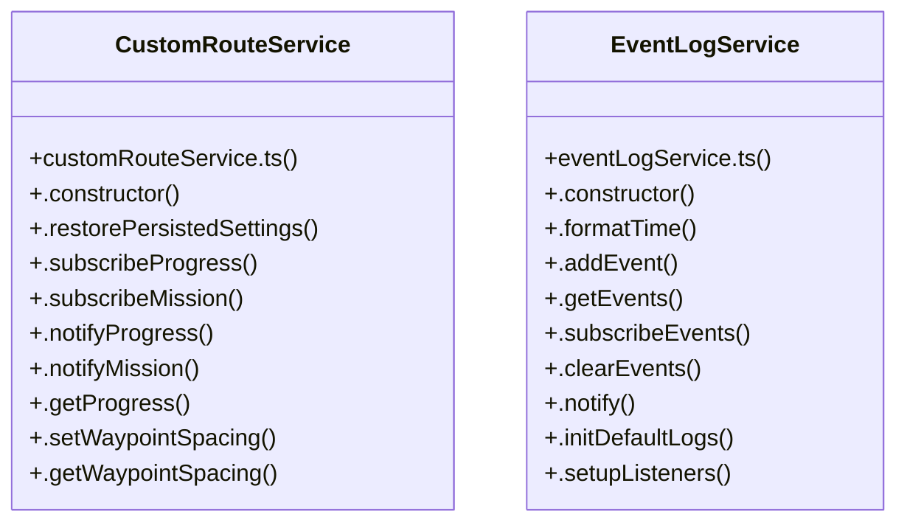

# Custom Route & Waypoint Plan

> 58 nodes · cohesion 0.05

## Key Concepts

- [CustomRouteService](file:///C:/Antigravityyyyy/last%20drone/skycon/frontend/src/services/customRouteService.ts#L37) (35 connections)
- [.rebuildMission()](file:///C:/Antigravityyyyy/last%20drone/skycon/frontend/src/services/customRouteService.ts#L262) (14 connections)
- [.addEvent()](file:///C:/Antigravityyyyy/last%20drone/skycon/frontend/src/services/eventLogService.ts#L49) (11 connections)
- [TelemetryLog.tsx](file:///C:/Antigravityyyyy/last%20drone/skycon/frontend/src/features/dashboard/TelemetryLog.tsx#L1) (11 connections)
- [EventLogService](file:///C:/Antigravityyyyy/last%20drone/skycon/frontend/src/services/eventLogService.ts#L17) (10 connections)
- [.notifyProgress()](file:///C:/Antigravityyyyy/last%20drone/skycon/frontend/src/services/customRouteService.ts#L94) (7 connections)
- [.startExecution()](file:///C:/Antigravityyyyy/last%20drone/skycon/frontend/src/services/customRouteService.ts#L533) (7 connections)
- [.getProgress()](file:///C:/Antigravityyyyy/last%20drone/skycon/frontend/src/services/customRouteService.ts#L103) (6 connections)
- [.clearRoute()](file:///C:/Antigravityyyyy/last%20drone/skycon/frontend/src/services/customRouteService.ts#L207) (4 connections)
- [.handleRouteCompleted()](file:///C:/Antigravityyyyy/last%20drone/skycon/frontend/src/services/customRouteService.ts#L670) (4 connections)
- [.handleTargetReached()](file:///C:/Antigravityyyyy/last%20drone/skycon/frontend/src/services/customRouteService.ts#L638) (4 connections)
- [.notifyMission()](file:///C:/Antigravityyyyy/last%20drone/skycon/frontend/src/services/customRouteService.ts#L99) (4 connections)
- [.stopExecution()](file:///C:/Antigravityyyyy/last%20drone/skycon/frontend/src/services/customRouteService.ts#L681) (4 connections)
- [.notify()](file:///C:/Antigravityyyyy/last%20drone/skycon/frontend/src/services/eventLogService.ts#L80) (4 connections)
- [.goToTarget()](file:///C:/Antigravityyyyy/last%20drone/skycon/frontend/src/services/customRouteService.ts#L692) (3 connections)
- [.interpolateLine()](file:///C:/Antigravityyyyy/last%20drone/skycon/frontend/src/services/customRouteService.ts#L234) (3 connections)
- [.reverseRoute()](file:///C:/Antigravityyyyy/last%20drone/skycon/frontend/src/services/customRouteService.ts#L223) (3 connections)
- [.setMissionAltitude()](file:///C:/Antigravityyyyy/last%20drone/skycon/frontend/src/services/customRouteService.ts#L137) (3 connections)
- [.setWaypointSpacing()](file:///C:/Antigravityyyyy/last%20drone/skycon/frontend/src/services/customRouteService.ts#L127) (3 connections)
- [.clearEvents()](file:///C:/Antigravityyyyy/last%20drone/skycon/frontend/src/services/eventLogService.ts#L75) (3 connections)
- [.constructor()](file:///C:/Antigravityyyyy/last%20drone/skycon/frontend/src/services/eventLogService.ts#L30) (3 connections)
- [.formatTime()](file:///C:/Antigravityyyyy/last%20drone/skycon/frontend/src/services/eventLogService.ts#L41) (3 connections)
- [.getEvents()](file:///C:/Antigravityyyyy/last%20drone/skycon/frontend/src/services/eventLogService.ts#L65) (3 connections)
- [.initDefaultLogs()](file:///C:/Antigravityyyyy/last%20drone/skycon/frontend/src/services/eventLogService.ts#L85) (3 connections)
- [handleAltitudeChange()](file:///C:/Antigravityyyyy/last%20drone/skycon/frontend/src/components/GroundStation/MissionConfigurationCard.tsx#L73) (3 connections)
- *... and 33 more nodes in this community*

## Class Diagram

## Relationships

- No strong cross-community connections detected

## Source Files

- [skycon\frontend\src\components\GroundStation\MissionConfigurationCard.tsx](file:///C:/Antigravityyyyy/last%20drone/skycon/frontend/src/components/GroundStation/MissionConfigurationCard.tsx)
- [skycon\frontend\src\features\dashboard\TelemetryLog.tsx](file:///C:/Antigravityyyyy/last%20drone/skycon/frontend/src/features/dashboard/TelemetryLog.tsx)
- [skycon\frontend\src\services\customRouteService.ts](file:///C:/Antigravityyyyy/last%20drone/skycon/frontend/src/services/customRouteService.ts)
- [skycon\frontend\src\services\eventLogService.ts](file:///C:/Antigravityyyyy/last%20drone/skycon/frontend/src/services/eventLogService.ts)

## Audit Trail

- EXTRACTED: 166 (81%)
- INFERRED: 38 (19%)
- AMBIGUOUS: 0 (0%)

---

*Part of the graphify knowledge wiki. See [[index]] to navigate.*