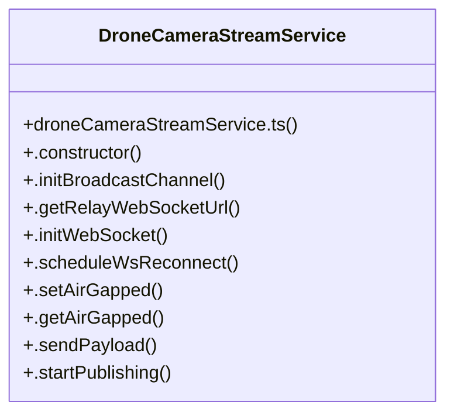

# Dronecamerastreamser

> 35 nodes · cohesion 0.09

## Key Concepts

- [DroneCameraStreamService](file:///C:/Antigravityyyyy/last%20drone/skycon/frontend/src/services/droneCameraStreamService.ts#L41) (31 connections)
- [.sendPayload()](file:///C:/Antigravityyyyy/last%20drone/skycon/frontend/src/services/droneCameraStreamService.ts#L195) (9 connections)
- [.handleIncomingPayload()](file:///C:/Antigravityyyyy/last%20drone/skycon/frontend/src/services/droneCameraStreamService.ts#L454) (7 connections)
- [.initWebSocket()](file:///C:/Antigravityyyyy/last%20drone/skycon/frontend/src/services/droneCameraStreamService.ts#L123) (4 connections)
- [.startPublishing()](file:///C:/Antigravityyyyy/last%20drone/skycon/frontend/src/services/droneCameraStreamService.ts#L221) (4 connections)
- [.updateStatus()](file:///C:/Antigravityyyyy/last%20drone/skycon/frontend/src/services/droneCameraStreamService.ts#L615) (4 connections)
- [droneCameraStreamService.ts](file:///C:/Antigravityyyyy/last%20drone/skycon/frontend/src/services/droneCameraStreamService.ts#L1) (4 connections)
- [.captureAndSendSingleFrame()](file:///C:/Antigravityyyyy/last%20drone/skycon/frontend/src/services/droneCameraStreamService.ts#L394) (3 connections)
- [.checkSubscriberLiveness()](file:///C:/Antigravityyyyy/last%20drone/skycon/frontend/src/services/droneCameraStreamService.ts#L581) (3 connections)
- [.constructor()](file:///C:/Antigravityyyyy/last%20drone/skycon/frontend/src/services/droneCameraStreamService.ts#L77) (3 connections)
- [.handleWebRTCSignal()](file:///C:/Antigravityyyyy/last%20drone/skycon/frontend/src/services/droneCameraStreamService.ts#L519) (3 connections)
- [.startSubscribing()](file:///C:/Antigravityyyyy/last%20drone/skycon/frontend/src/services/droneCameraStreamService.ts#L422) (3 connections)
- [.stopPublishing()](file:///C:/Antigravityyyyy/last%20drone/skycon/frontend/src/services/droneCameraStreamService.ts#L262) (3 connections)
- [.getAirGapped()](file:///C:/Antigravityyyyy/last%20drone/skycon/frontend/src/services/droneCameraStreamService.ts#L191) (2 connections)
- [.getRelayWebSocketUrl()](file:///C:/Antigravityyyyy/last%20drone/skycon/frontend/src/services/droneCameraStreamService.ts#L99) (2 connections)
- [.initBroadcastChannel()](file:///C:/Antigravityyyyy/last%20drone/skycon/frontend/src/services/droneCameraStreamService.ts#L86) (2 connections)
- [.initPublisherPeerConnection()](file:///C:/Antigravityyyyy/last%20drone/skycon/frontend/src/services/droneCameraStreamService.ts#L295) (2 connections)
- [.notifyFrame()](file:///C:/Antigravityyyyy/last%20drone/skycon/frontend/src/services/droneCameraStreamService.ts#L653) (2 connections)
- [.notifyStatus()](file:///C:/Antigravityyyyy/last%20drone/skycon/frontend/src/services/droneCameraStreamService.ts#L645) (2 connections)
- [.notifyStream()](file:///C:/Antigravityyyyy/last%20drone/skycon/frontend/src/services/droneCameraStreamService.ts#L649) (2 connections)
- [.scheduleWsReconnect()](file:///C:/Antigravityyyyy/last%20drone/skycon/frontend/src/services/droneCameraStreamService.ts#L175) (2 connections)
- [.setAirGapped()](file:///C:/Antigravityyyyy/last%20drone/skycon/frontend/src/services/droneCameraStreamService.ts#L184) (2 connections)
- [.startFrameCaptureLoop()](file:///C:/Antigravityyyyy/last%20drone/skycon/frontend/src/services/droneCameraStreamService.ts#L349) (2 connections)
- [BROADCAST_CHANNEL_NAME](file:///C:/Antigravityyyyy/last%20drone/skycon/frontend/src/services/droneCameraStreamService.ts#L37) (1 connections)
- [DEFAULT_SECURE_RELAY_URL](file:///C:/Antigravityyyyy/last%20drone/skycon/frontend/src/services/droneCameraStreamService.ts#L39) (1 connections)
- *... and 10 more nodes in this community*

## Class Diagram

## Relationships

- No strong cross-community connections detected

## Source Files

- [skycon\frontend\src\services\droneCameraStreamService.ts](file:///C:/Antigravityyyyy/last%20drone/skycon/frontend/src/services/droneCameraStreamService.ts)

## Audit Trail

- EXTRACTED: 110 (97%)
- INFERRED: 3 (3%)
- AMBIGUOUS: 0 (0%)

---

*Part of the graphify knowledge wiki. See [[index]] to navigate.*