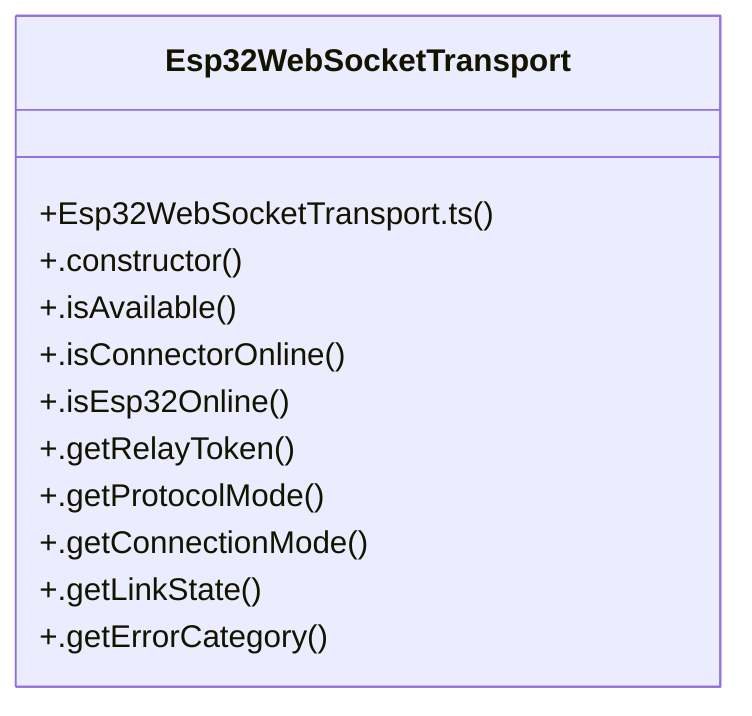

# ESP32-S3 Wireless Telemetry

> 61 nodes · cohesion 0.05

## Key Concepts

- [Esp32WebSocketTransport](file:///C:/Antigravityyyyy/last%20drone/skycon/frontend/src/services/transports/Esp32WebSocketTransport.ts#L56) (41 connections)
- [Esp32WebSocketTransport.ts](file:///C:/Antigravityyyyy/last%20drone/skycon/frontend/src/services/transports/Esp32WebSocketTransport.ts#L1) (9 connections)
- [.connect()](file:///C:/Antigravityyyyy/last%20drone/skycon/frontend/src/services/transports/Esp32WebSocketTransport.ts#L507) (8 connections)
- [mavlinkService.ts](file:///C:/Antigravityyyyy/last%20drone/skycon/frontend/src/services/mavlinkService.ts#L1) (7 connections)
- [.attemptConnection()](file:///C:/Antigravityyyyy/last%20drone/skycon/frontend/src/services/transports/Esp32WebSocketTransport.ts#L552) (6 connections)
- [.getResolvedUrl()](file:///C:/Antigravityyyyy/last%20drone/skycon/frontend/src/services/transports/Esp32WebSocketTransport.ts#L350) (6 connections)
- [.disconnect()](file:///C:/Antigravityyyyy/last%20drone/skycon/frontend/src/services/transports/Esp32WebSocketTransport.ts#L937) (5 connections)
- [.notifyState()](file:///C:/Antigravityyyyy/last%20drone/skycon/frontend/src/services/transports/Esp32WebSocketTransport.ts#L1037) (5 connections)
- [.determineProtocol()](file:///C:/Antigravityyyyy/last%20drone/skycon/frontend/src/services/transports/Esp32WebSocketTransport.ts#L322) (4 connections)
- [ArduPilot MAVLink Protocol Standards (Pixhawk 2.4.8)](file:///C:/Antigravityyyyy/last%20drone/skycon/GEMINI.md) (4 connections)
- [Hybrid Telemetry Transports (ESP32 / WSS / OTG Serial)](file:///C:/Antigravityyyyy/last%20drone/skycon/GEMINI.md) (4 connections)
- [GEMINI.md (Project Context & Rules)](file:///C:/Antigravityyyyy/last%20drone/skycon/GEMINI.md) (4 connections)
- [.cleanupSocket()](file:///C:/Antigravityyyyy/last%20drone/skycon/frontend/src/services/transports/Esp32WebSocketTransport.ts#L964) (3 connections)
- [.clearAllTimers()](file:///C:/Antigravityyyyy/last%20drone/skycon/frontend/src/services/transports/Esp32WebSocketTransport.ts#L982) (3 connections)
- [.handleWssFallback()](file:///C:/Antigravityyyyy/last%20drone/skycon/frontend/src/services/transports/Esp32WebSocketTransport.ts#L913) (3 connections)
- [.isConnected()](file:///C:/Antigravityyyyy/last%20drone/skycon/frontend/src/services/transports/Esp32WebSocketTransport.ts#L993) (3 connections)
- [.isReady()](file:///C:/Antigravityyyyy/last%20drone/skycon/frontend/src/services/transports/Esp32WebSocketTransport.ts#L997) (3 connections)
- [.send()](file:///C:/Antigravityyyyy/last%20drone/skycon/frontend/src/services/transports/Esp32WebSocketTransport.ts#L1008) (3 connections)
- [Altitude Tolerance & Level-Off Drift Protection (?1.0m)](file:///C:/Antigravityyyyy/last%20drone/skycon/GEMINI.md) (3 connections)
- [.checkEsp32Http()](file:///C:/Antigravityyyyy/last%20drone/skycon/frontend/src/services/transports/Esp32WebSocketTransport.ts#L458) (2 connections)
- [.constructor()](file:///C:/Antigravityyyyy/last%20drone/skycon/frontend/src/services/transports/Esp32WebSocketTransport.ts#L108) (2 connections)
- [.formatPath()](file:///C:/Antigravityyyyy/last%20drone/skycon/frontend/src/services/transports/Esp32WebSocketTransport.ts#L291) (2 connections)
- [.getDiagnostics()](file:///C:/Antigravityyyyy/last%20drone/skycon/frontend/src/services/transports/Esp32WebSocketTransport.ts#L1041) (2 connections)
- [.getErrorCategory()](file:///C:/Antigravityyyyy/last%20drone/skycon/frontend/src/services/transports/Esp32WebSocketTransport.ts#L218) (2 connections)
- [.getLastErrorMessage()](file:///C:/Antigravityyyyy/last%20drone/skycon/frontend/src/services/transports/Esp32WebSocketTransport.ts#L222) (2 connections)
- *... and 36 more nodes in this community*

## Class Diagram

## Relationships

- No strong cross-community connections detected

## Source Files

- [skycon\.agents\rules\drone-safety-and-mavlink.md](file:///C:/Antigravityyyyy/last%20drone/skycon/.agents/rules/drone-safety-and-mavlink.md)
- [skycon\GEMINI.md](file:///C:/Antigravityyyyy/last%20drone/skycon/GEMINI.md)
- [skycon\frontend\src\components\Drone\PixhawkConnectionCard.tsx](file:///C:/Antigravityyyyy/last%20drone/skycon/frontend/src/components/Drone/PixhawkConnectionCard.tsx)
- [skycon\frontend\src\services\mavlinkService.ts](file:///C:/Antigravityyyyy/last%20drone/skycon/frontend/src/services/mavlinkService.ts)
- [skycon\frontend\src\services\transports\Esp32WebSocketTransport.ts](file:///C:/Antigravityyyyy/last%20drone/skycon/frontend/src/services/transports/Esp32WebSocketTransport.ts)
- [skycon\reference docs\ADDC RULE BOOK.pdf](file:///C:/Antigravityyyyy/last%20drone/skycon/reference%20docs/ADDC%20RULE%20BOOK.pdf)

## Audit Trail

- EXTRACTED: 165 (88%)
- INFERRED: 22 (12%)
- AMBIGUOUS: 0 (0%)

---

*Part of the graphify knowledge wiki. See [[index]] to navigate.*