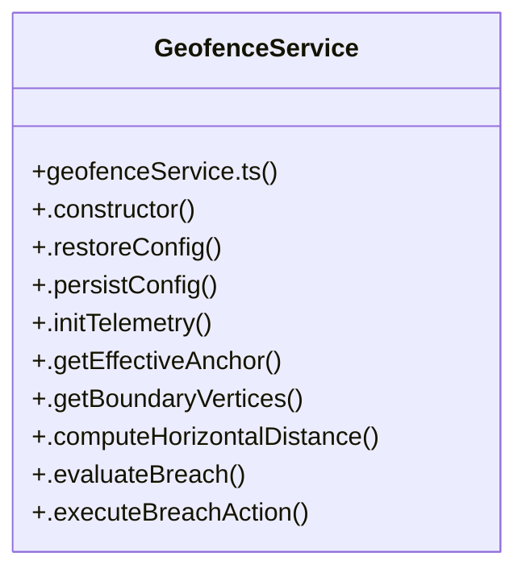

# Geofenceservice Subsystem

> 46 nodes · cohesion 0.08

## Key Concepts

- [GeofenceService](file:///C:/Antigravityyyyy/last%20drone/skycon/frontend/src/services/geofenceService.ts#L106) (20 connections)
- [GeofenceControlModal.tsx](file:///C:/Antigravityyyyy/last%20drone/skycon/frontend/src/components/GroundStation/GeofenceControlModal.tsx#L1) (19 connections)
- [.notify()](file:///C:/Antigravityyyyy/last%20drone/skycon/frontend/src/services/geofenceService.ts#L535) (8 connections)
- [.canArmVehicle()](file:///C:/Antigravityyyyy/last%20drone/skycon/frontend/src/services/geofenceService.ts#L499) (7 connections)
- [.evaluateBreach()](file:///C:/Antigravityyyyy/last%20drone/skycon/frontend/src/services/geofenceService.ts#L267) (7 connections)
- [.getEffectiveAnchor()](file:///C:/Antigravityyyyy/last%20drone/skycon/frontend/src/services/geofenceService.ts#L160) (7 connections)
- [.isInsideGeofence()](file:///C:/Antigravityyyyy/last%20drone/skycon/frontend/src/services/geofenceService.ts#L473) (6 connections)
- [.persistConfig()](file:///C:/Antigravityyyyy/last%20drone/skycon/frontend/src/services/geofenceService.ts#L147) (6 connections)
- [.setEnabled()](file:///C:/Antigravityyyyy/last%20drone/skycon/frontend/src/services/geofenceService.ts#L399) (6 connections)
- [geofenceService.ts](file:///C:/Antigravityyyyy/last%20drone/skycon/frontend/src/services/geofenceService.ts#L1) (6 connections)
- [showNotification()](file:///C:/Antigravityyyyy/last%20drone/skycon/frontend/src/components/GroundStation/GeofenceControlModal.tsx#L57) (5 connections)
- [.clearGeofence()](file:///C:/Antigravityyyyy/last%20drone/skycon/frontend/src/services/geofenceService.ts#L439) (5 connections)
- [.getBoundaryVertices()](file:///C:/Antigravityyyyy/last%20drone/skycon/frontend/src/services/geofenceService.ts#L181) (5 connections)
- [.resetToADDCDefaults()](file:///C:/Antigravityyyyy/last%20drone/skycon/frontend/src/services/geofenceService.ts#L421) (5 connections)
- [handleApplyADDCDefaults()](file:///C:/Antigravityyyyy/last%20drone/skycon/frontend/src/components/GroundStation/GeofenceControlModal.tsx#L70) (4 connections)
- [handleClearGeofence()](file:///C:/Antigravityyyyy/last%20drone/skycon/frontend/src/components/GroundStation/GeofenceControlModal.tsx#L100) (4 connections)
- [handleSaveConfig()](file:///C:/Antigravityyyyy/last%20drone/skycon/frontend/src/components/GroundStation/GeofenceControlModal.tsx#L83) (4 connections)
- [handleToggleEnabled()](file:///C:/Antigravityyyyy/last%20drone/skycon/frontend/src/components/GroundStation/GeofenceControlModal.tsx#L62) (4 connections)
- [computeHaversine()](file:///C:/Antigravityyyyy/last%20drone/skycon/frontend/src/services/geofenceService.ts#L80) (4 connections)
- [.computeHorizontalDistance()](file:///C:/Antigravityyyyy/last%20drone/skycon/frontend/src/services/geofenceService.ts#L220) (4 connections)
- [.setCustomAnchor()](file:///C:/Antigravityyyyy/last%20drone/skycon/frontend/src/services/geofenceService.ts#L456) (4 connections)
- [.constructor()](file:///C:/Antigravityyyyy/last%20drone/skycon/frontend/src/services/geofenceService.ts#L120) (3 connections)
- [.executeBreachAction()](file:///C:/Antigravityyyyy/last%20drone/skycon/frontend/src/services/geofenceService.ts#L382) (3 connections)
- [.getState()](file:///C:/Antigravityyyyy/last%20drone/skycon/frontend/src/services/geofenceService.ts#L525) (3 connections)
- [.initTelemetry()](file:///C:/Antigravityyyyy/last%20drone/skycon/frontend/src/services/geofenceService.ts#L154) (3 connections)
- *... and 21 more nodes in this community*

## Class Diagram

## Relationships

- No strong cross-community connections detected

## Source Files

- [skycon\frontend\src\components\GroundStation\GeofenceControlModal.tsx](file:///C:/Antigravityyyyy/last%20drone/skycon/frontend/src/components/GroundStation/GeofenceControlModal.tsx)
- [skycon\frontend\src\services\geofenceService.ts](file:///C:/Antigravityyyyy/last%20drone/skycon/frontend/src/services/geofenceService.ts)

## Audit Trail

- EXTRACTED: 154 (86%)
- INFERRED: 26 (14%)
- AMBIGUOUS: 0 (0%)

---

*Part of the graphify knowledge wiki. See [[index]] to navigate.*