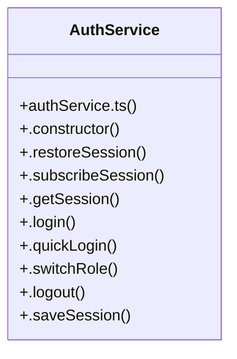

# HUD Telemetry Deck & Failsaf

> 61 nodes · cohesion 0.04

## Key Concepts

- [App.tsx](file:///C:/Antigravityyyyy/last%20drone/skycon/frontend/src/App.tsx#L1) (28 connections)
- [AuthService](file:///C:/Antigravityyyyy/last%20drone/skycon/frontend/src/services/authService.ts#L48) (11 connections)
- [LoginScreen.tsx](file:///C:/Antigravityyyyy/last%20drone/skycon/frontend/src/components/Auth/LoginScreen.tsx#L1) (11 connections)
- [test-login-page.ts](file:///C:/Antigravityyyyy/last%20drone/skycon/tests/test-login-page.ts#L1) (6 connections)
- [.login()](file:///C:/Antigravityyyyy/last%20drone/skycon/frontend/src/services/authService.ts#L78) (5 connections)
- [runLoginTests()](file:///C:/Antigravityyyyy/last%20drone/skycon/tests/test-login-page.ts#L44) (5 connections)
- [.logout()](file:///C:/Antigravityyyyy/last%20drone/skycon/frontend/src/services/authService.ts#L136) (4 connections)
- [.saveSession()](file:///C:/Antigravityyyyy/last%20drone/skycon/frontend/src/services/authService.ts#L144) (4 connections)
- [.notify()](file:///C:/Antigravityyyyy/last%20drone/skycon/frontend/src/services/authService.ts#L152) (3 connections)
- [authService.ts](file:///C:/Antigravityyyyy/last%20drone/skycon/frontend/src/services/authService.ts#L1) (3 connections)
- [handleEmergencyRTL()](file:///C:/Antigravityyyyy/last%20drone/skycon/frontend/src/App.tsx#L108) (2 connections)
- [handleLogout()](file:///C:/Antigravityyyyy/last%20drone/skycon/frontend/src/App.tsx#L123) (2 connections)
- [handleResetMission()](file:///C:/Antigravityyyyy/last%20drone/skycon/frontend/src/App.tsx#L112) (2 connections)
- [unsubRunner](file:///C:/Antigravityyyyy/last%20drone/skycon/frontend/src/App.tsx#L60) (2 connections)
- [.constructor()](file:///C:/Antigravityyyyy/last%20drone/skycon/frontend/src/services/authService.ts#L52) (2 connections)
- [.getSession()](file:///C:/Antigravityyyyy/last%20drone/skycon/frontend/src/services/authService.ts#L74) (2 connections)
- [.quickLogin()](file:///C:/Antigravityyyyy/last%20drone/skycon/frontend/src/services/authService.ts#L112) (2 connections)
- [.restoreSession()](file:///C:/Antigravityyyyy/last%20drone/skycon/frontend/src/services/authService.ts#L56) (2 connections)
- [.switchRole()](file:///C:/Antigravityyyyy/last%20drone/skycon/frontend/src/services/authService.ts#L123) (2 connections)
- [handleLoginSubmit()](file:///C:/Antigravityyyyy/last%20drone/skycon/frontend/src/components/Auth/LoginScreen.tsx#L46) (2 connections)
- [Tactical Dark HUD Ground Station (React 18 + Netlify)](file:///C:/Antigravityyyyy/last%20drone/skycon/frontend/README.md) (2 connections)
- [assert()](file:///C:/Antigravityyyyy/last%20drone/skycon/tests/test-login-page.ts#L34) (2 connections)
- [currentRole](file:///C:/Antigravityyyyy/last%20drone/skycon/frontend/src/App.tsx#L142) (1 connections)
- [[decodedQR, setDecodedQR]](file:///C:/Antigravityyyyy/last%20drone/skycon/frontend/src/App.tsx#L31) (1 connections)
- [[elapsedSeconds, setElapsedSeconds]](file:///C:/Antigravityyyyy/last%20drone/skycon/frontend/src/App.tsx#L30) (1 connections)
- *... and 36 more nodes in this community*

## Class Diagram

## Relationships

- No strong cross-community connections detected

## Source Files

- [skycon\frontend\README.md](file:///C:/Antigravityyyyy/last%20drone/skycon/frontend/README.md)
- [skycon\frontend\src\App.tsx](file:///C:/Antigravityyyyy/last%20drone/skycon/frontend/src/App.tsx)
- [skycon\frontend\src\components\Auth\LoginScreen.tsx](file:///C:/Antigravityyyyy/last%20drone/skycon/frontend/src/components/Auth/LoginScreen.tsx)
- [skycon\frontend\src\services\authService.ts](file:///C:/Antigravityyyyy/last%20drone/skycon/frontend/src/services/authService.ts)
- [skycon\tests\test-login-page.ts](file:///C:/Antigravityyyyy/last%20drone/skycon/tests/test-login-page.ts)

## Audit Trail

- EXTRACTED: 128 (90%)
- INFERRED: 15 (10%)
- AMBIGUOUS: 0 (0%)

---

*Part of the graphify knowledge wiki. See [[index]] to navigate.*