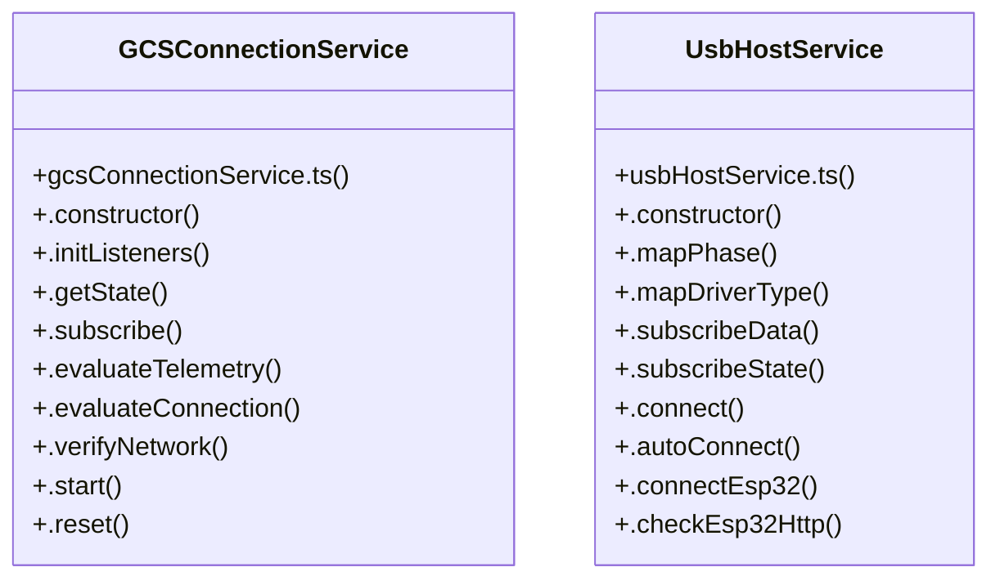

# Header Subsystem

> 52 nodes · cohesion 0.05

## Key Concepts

- [Header.tsx](file:///C:/Antigravityyyyy/last%20drone/skycon/frontend/src/features/dashboard/Header.tsx#L1) (19 connections)
- [UsbHostService](file:///C:/Antigravityyyyy/last%20drone/skycon/frontend/src/services/usbHostService.ts#L7) (19 connections)
- [.start()](file:///C:/Antigravityyyyy/last%20drone/skycon/frontend/src/services/gcsConnectionService.ts#L232) (12 connections)
- [GCSConnectionService](file:///C:/Antigravityyyyy/last%20drone/skycon/frontend/src/services/gcsConnectionService.ts#L35) (11 connections)
- [.getConnectionState()](file:///C:/Antigravityyyyy/last%20drone/skycon/frontend/src/services/mavlinkService.ts#L688) (9 connections)
- [.notify()](file:///C:/Antigravityyyyy/last%20drone/skycon/frontend/src/services/gcsConnectionService.ts#L304) (7 connections)
- [.autoConnect()](file:///C:/Antigravityyyyy/last%20drone/skycon/frontend/src/services/usbHostService.ts#L103) (5 connections)
- [.evaluateTelemetry()](file:///C:/Antigravityyyyy/last%20drone/skycon/frontend/src/services/gcsConnectionService.ts#L99) (4 connections)
- [.getState()](file:///C:/Antigravityyyyy/last%20drone/skycon/frontend/src/services/gcsConnectionService.ts#L86) (4 connections)
- [.initListeners()](file:///C:/Antigravityyyyy/last%20drone/skycon/frontend/src/services/gcsConnectionService.ts#L59) (4 connections)
- [.subscribeConnection()](file:///C:/Antigravityyyyy/last%20drone/skycon/frontend/src/services/mavlinkService.ts#L678) (4 connections)
- [.evaluateConnection()](file:///C:/Antigravityyyyy/last%20drone/skycon/frontend/src/services/gcsConnectionService.ts#L161) (3 connections)
- [.verifyNetwork()](file:///C:/Antigravityyyyy/last%20drone/skycon/frontend/src/services/gcsConnectionService.ts#L188) (3 connections)
- [.constructor()](file:///C:/Antigravityyyyy/last%20drone/skycon/frontend/src/services/usbHostService.ts#L13) (3 connections)
- [.getDiagnostics()](file:///C:/Antigravityyyyy/last%20drone/skycon/frontend/src/services/usbHostService.ts#L132) (3 connections)
- [.constructor()](file:///C:/Antigravityyyyy/last%20drone/skycon/frontend/src/services/gcsConnectionService.ts#L55) (2 connections)
- [.reset()](file:///C:/Antigravityyyyy/last%20drone/skycon/frontend/src/services/gcsConnectionService.ts#L284) (2 connections)
- [.subscribe()](file:///C:/Antigravityyyyy/last%20drone/skycon/frontend/src/services/gcsConnectionService.ts#L90) (2 connections)
- [handleStartConnections()](file:///C:/Antigravityyyyy/last%20drone/skycon/frontend/src/features/dashboard/Header.tsx#L58) (2 connections)
- [.connect()](file:///C:/Antigravityyyyy/last%20drone/skycon/frontend/src/services/usbHostService.ts#L99) (2 connections)
- [.getActiveTransport()](file:///C:/Antigravityyyyy/last%20drone/skycon/frontend/src/services/usbHostService.ts#L159) (2 connections)
- [.mapDriverType()](file:///C:/Antigravityyyyy/last%20drone/skycon/frontend/src/services/usbHostService.ts#L76) (2 connections)
- [.subscribeData()](file:///C:/Antigravityyyyy/last%20drone/skycon/frontend/src/services/usbHostService.ts#L89) (2 connections)
- [.subscribeState()](file:///C:/Antigravityyyyy/last%20drone/skycon/frontend/src/services/usbHostService.ts#L94) (2 connections)
- [[connState, setConnState]](file:///C:/Antigravityyyyy/last%20drone/skycon/frontend/src/features/dashboard/Header.tsx#L49) (1 connections)
- *... and 27 more nodes in this community*

## Class Diagram

## Relationships

- No strong cross-community connections detected

## Source Files

- [skycon\frontend\src\features\dashboard\Header.tsx](file:///C:/Antigravityyyyy/last%20drone/skycon/frontend/src/features/dashboard/Header.tsx)
- [skycon\frontend\src\services\gcsConnectionService.ts](file:///C:/Antigravityyyyy/last%20drone/skycon/frontend/src/services/gcsConnectionService.ts)
- [skycon\frontend\src\services\mavlinkService.ts](file:///C:/Antigravityyyyy/last%20drone/skycon/frontend/src/services/mavlinkService.ts)
- [skycon\frontend\src\services\usbHostService.ts](file:///C:/Antigravityyyyy/last%20drone/skycon/frontend/src/services/usbHostService.ts)

## Audit Trail

- EXTRACTED: 135 (87%)
- INFERRED: 21 (13%)
- AMBIGUOUS: 0 (0%)

---

*Part of the graphify knowledge wiki. See [[index]] to navigate.*