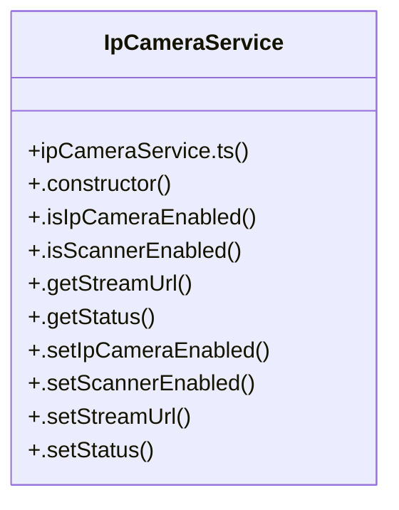

# Ipcameraservice Subsystem

> 36 nodes · cohesion 0.07

## Key Concepts

- [IpCameraService](file:///C:/Antigravityyyyy/last%20drone/skycon/frontend/src/services/ipCameraService.ts#L19) (29 connections)
- [.notifyZoom()](file:///C:/Antigravityyyyy/last%20drone/skycon/frontend/src/services/ipCameraService.ts#L238) (5 connections)
- [ipCameraService.ts](file:///C:/Antigravityyyyy/last%20drone/skycon/frontend/src/services/ipCameraService.ts#L1) (5 connections)
- [.notifyStatus()](file:///C:/Antigravityyyyy/last%20drone/skycon/frontend/src/services/ipCameraService.ts#L146) (4 connections)
- [.setIpCameraEnabled()](file:///C:/Antigravityyyyy/last%20drone/skycon/frontend/src/services/ipCameraService.ts#L82) (4 connections)
- [.setStreamUrl()](file:///C:/Antigravityyyyy/last%20drone/skycon/frontend/src/services/ipCameraService.ts#L102) (3 connections)
- [.lockZoom()](file:///C:/Antigravityyyyy/last%20drone/skycon/frontend/src/services/ipCameraService.ts#L219) (2 connections)
- [.notifyScanner()](file:///C:/Antigravityyyyy/last%20drone/skycon/frontend/src/services/ipCameraService.ts#L166) (2 connections)
- [.notifyToggle()](file:///C:/Antigravityyyyy/last%20drone/skycon/frontend/src/services/ipCameraService.ts#L156) (2 connections)
- [.notifyUrl()](file:///C:/Antigravityyyyy/last%20drone/skycon/frontend/src/services/ipCameraService.ts#L176) (2 connections)
- [.setAutoZoomSweeping()](file:///C:/Antigravityyyyy/last%20drone/skycon/frontend/src/services/ipCameraService.ts#L209) (2 connections)
- [.setScannerEnabled()](file:///C:/Antigravityyyyy/last%20drone/skycon/frontend/src/services/ipCameraService.ts#L93) (2 connections)
- [.setStatus()](file:///C:/Antigravityyyyy/last%20drone/skycon/frontend/src/services/ipCameraService.ts#L116) (2 connections)
- [.setZoom()](file:///C:/Antigravityyyyy/last%20drone/skycon/frontend/src/services/ipCameraService.ts#L202) (2 connections)
- [.unlockZoom()](file:///C:/Antigravityyyyy/last%20drone/skycon/frontend/src/services/ipCameraService.ts#L226) (2 connections)
- [LiveVideoFeed()](file:///C:/Antigravityyyyy/last%20drone/skycon/frontend/src/components/GroundStation/LiveVideoFeed.tsx#L14) (2 connections)
- [LiveVideoFeed.tsx](file:///C:/Antigravityyyyy/last%20drone/skycon/frontend/src/components/GroundStation/LiveVideoFeed.tsx#L1) (2 connections)
- [DEFAULT_URL](file:///C:/Antigravityyyyy/last%20drone/skycon/frontend/src/services/ipCameraService.ts#L17) (1 connections)
- [.constructor()](file:///C:/Antigravityyyyy/last%20drone/skycon/frontend/src/services/ipCameraService.ts#L35) (1 connections)
- [.getLockedCode()](file:///C:/Antigravityyyyy/last%20drone/skycon/frontend/src/services/ipCameraService.ts#L198) (1 connections)
- [.getStatus()](file:///C:/Antigravityyyyy/last%20drone/skycon/frontend/src/services/ipCameraService.ts#L78) (1 connections)
- [.getStreamUrl()](file:///C:/Antigravityyyyy/last%20drone/skycon/frontend/src/services/ipCameraService.ts#L74) (1 connections)
- [.isAutoZoom()](file:///C:/Antigravityyyyy/last%20drone/skycon/frontend/src/services/ipCameraService.ts#L190) (1 connections)
- [.isIpCameraEnabled()](file:///C:/Antigravityyyyy/last%20drone/skycon/frontend/src/services/ipCameraService.ts#L66) (1 connections)
- [.isLocked()](file:///C:/Antigravityyyyy/last%20drone/skycon/frontend/src/services/ipCameraService.ts#L194) (1 connections)
- *... and 11 more nodes in this community*

## Class Diagram

## Relationships

- No strong cross-community connections detected

## Source Files

- [skycon\frontend\src\components\GroundStation\LiveVideoFeed.tsx](file:///C:/Antigravityyyyy/last%20drone/skycon/frontend/src/components/GroundStation/LiveVideoFeed.tsx)
- [skycon\frontend\src\services\ipCameraService.ts](file:///C:/Antigravityyyyy/last%20drone/skycon/frontend/src/services/ipCameraService.ts)

## Audit Trail

- EXTRACTED: 89 (98%)
- INFERRED: 2 (2%)
- AMBIGUOUS: 0 (0%)

---

*Part of the graphify knowledge wiki. See [[index]] to navigate.*