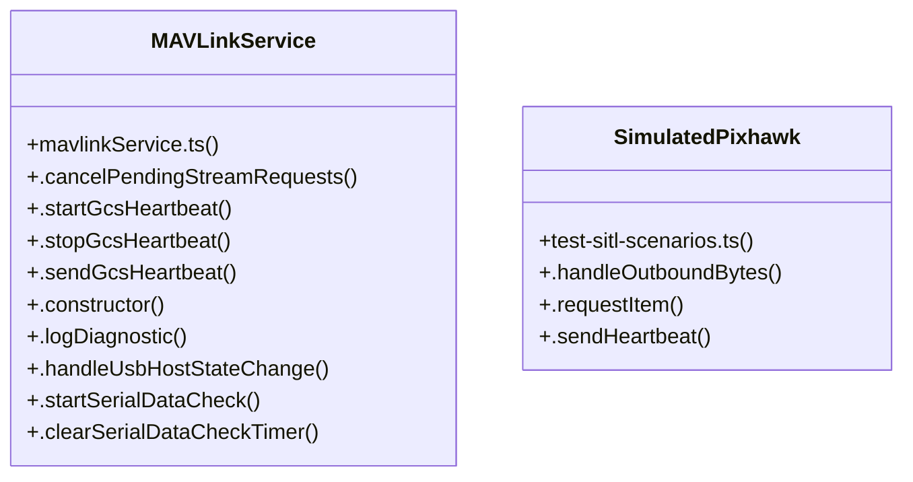

# MAVLink Protocol & Telemetry

> 125 nodes · cohesion 0.05

## Key Concepts

- [MAVLinkService](file:///C:/Antigravityyyyy/last%20drone/skycon/frontend/src/services/mavlinkService.ts#L153) (96 connections)
- [.logDiagnostic()](file:///C:/Antigravityyyyy/last%20drone/skycon/frontend/src/services/mavlinkService.ts#L397) (42 connections)
- [.setFlightMode()](file:///C:/Antigravityyyyy/last%20drone/skycon/frontend/src/services/mavlinkService.ts#L2576) (30 connections)
- [.notifyTelemetry()](file:///C:/Antigravityyyyy/last%20drone/skycon/frontend/src/services/mavlinkService.ts#L4067) (26 connections)
- [runAllTests()](file:///C:/Antigravityyyyy/last%20drone/skycon/tests/test-all-systems.ts#L54) (26 connections)
- [.notifyConnection()](file:///C:/Antigravityyyyy/last%20drone/skycon/frontend/src/services/mavlinkService.ts#L4072) (24 connections)
- [.addStatusMessage()](file:///C:/Antigravityyyyy/last%20drone/skycon/frontend/src/services/mavlinkService.ts#L768) (23 connections)
- [.handleUsbHostStateChange()](file:///C:/Antigravityyyyy/last%20drone/skycon/frontend/src/services/mavlinkService.ts#L409) (23 connections)
- [.sendMavlinkCommandLong()](file:///C:/Antigravityyyyy/last%20drone/skycon/frontend/src/services/mavlinkService.ts#L3723) (23 connections)
- [.handleParsedMavlinkMessage()](file:///C:/Antigravityyyyy/last%20drone/skycon/frontend/src/services/mavlinkService.ts#L1220) (19 connections)
- [.sendArmCommand()](file:///C:/Antigravityyyyy/last%20drone/skycon/frontend/src/services/mavlinkService.ts#L2379) (18 connections)
- [runTests()](file:///C:/Antigravityyyyy/last%20drone/skycon/tests/test-transport-connectivity-watchdog.ts#L125) (18 connections)
- [.commandRTL()](file:///C:/Antigravityyyyy/last%20drone/skycon/frontend/src/services/mavlinkService.ts#L2903) (17 connections)
- [.isReady()](file:///C:/Antigravityyyyy/last%20drone/skycon/frontend/src/services/transports/WebUsbTransport.ts#L129) (17 connections)
- [.flyToPosition()](file:///C:/Antigravityyyyy/last%20drone/skycon/frontend/src/services/mavlinkService.ts#L2724) (16 connections)
- [.commandTakeoff()](file:///C:/Antigravityyyyy/last%20drone/skycon/frontend/src/services/mavlinkService.ts#L2646) (15 connections)
- [.sendDisarmCommand()](file:///C:/Antigravityyyyy/last%20drone/skycon/frontend/src/services/mavlinkService.ts#L2458) (14 connections)
- [runSimulationScenarios()](file:///C:/Antigravityyyyy/last%20drone/skycon/tests/test-sitl-scenarios.ts#L275) (14 connections)
- [.cleanupMavlinkConnection()](file:///C:/Antigravityyyyy/last%20drone/skycon/frontend/src/services/mavlinkService.ts#L1035) (12 connections)
- [.sendBytes()](file:///C:/Antigravityyyyy/last%20drone/skycon/frontend/src/services/usbHostService.ts#L124) (12 connections)
- [.startGroundStationMission()](file:///C:/Antigravityyyyy/last%20drone/skycon/frontend/src/services/groundStationMissionService.ts#L1204) (11 connections)
- [.checkHeartbeatWatchdog()](file:///C:/Antigravityyyyy/last%20drone/skycon/frontend/src/services/mavlinkService.ts#L585) (11 connections)
- [.commandVerticalAltitude()](file:///C:/Antigravityyyyy/last%20drone/skycon/frontend/src/services/mavlinkService.ts#L2779) (11 connections)
- [.sendMavlinkCommandInt()](file:///C:/Antigravityyyyy/last%20drone/skycon/frontend/src/services/mavlinkService.ts#L3662) (11 connections)
- [.buildMavlink1Frame()](file:///C:/Antigravityyyyy/last%20drone/skycon/frontend/src/services/mavlinkService.ts#L3810) (10 connections)
- *... and 100 more nodes in this community*

## Class Diagram

## Relationships

- No strong cross-community connections detected

## Source Files

- [skycon\frontend\src\components\GroundStation\GroundStationDashboard.tsx](file:///C:/Antigravityyyyy/last%20drone/skycon/frontend/src/components/GroundStation/GroundStationDashboard.tsx)
- [skycon\frontend\src\components\common\PreArmChecksPanel.tsx](file:///C:/Antigravityyyyy/last%20drone/skycon/frontend/src/components/common/PreArmChecksPanel.tsx)
- [skycon\frontend\src\features\dashboard\DashboardPage.tsx](file:///C:/Antigravityyyyy/last%20drone/skycon/frontend/src/features/dashboard/DashboardPage.tsx)
- [skycon\frontend\src\services\customRouteService.ts](file:///C:/Antigravityyyyy/last%20drone/skycon/frontend/src/services/customRouteService.ts)
- [skycon\frontend\src\services\groundStationMissionService.ts](file:///C:/Antigravityyyyy/last%20drone/skycon/frontend/src/services/groundStationMissionService.ts)
- [skycon\frontend\src\services\mavlinkService.ts](file:///C:/Antigravityyyyy/last%20drone/skycon/frontend/src/services/mavlinkService.ts)
- [skycon\frontend\src\services\transports\Esp32WebSocketTransport.ts](file:///C:/Antigravityyyyy/last%20drone/skycon/frontend/src/services/transports/Esp32WebSocketTransport.ts)
- [skycon\frontend\src\services\transports\TransportManager.ts](file:///C:/Antigravityyyyy/last%20drone/skycon/frontend/src/services/transports/TransportManager.ts)
- [skycon\frontend\src\services\transports\WebUsbTransport.ts](file:///C:/Antigravityyyyy/last%20drone/skycon/frontend/src/services/transports/WebUsbTransport.ts)
- [skycon\frontend\src\services\usbHostService.ts](file:///C:/Antigravityyyyy/last%20drone/skycon/frontend/src/services/usbHostService.ts)
- [skycon\tests\test-all-systems.ts](file:///C:/Antigravityyyyy/last%20drone/skycon/tests/test-all-systems.ts)
- [skycon\tests\test-sitl-scenarios.ts](file:///C:/Antigravityyyyy/last%20drone/skycon/tests/test-sitl-scenarios.ts)
- [skycon\tests\test-transport-connectivity-watchdog.ts](file:///C:/Antigravityyyyy/last%20drone/skycon/tests/test-transport-connectivity-watchdog.ts)

## Audit Trail

- EXTRACTED: 679 (71%)
- INFERRED: 284 (29%)
- AMBIGUOUS: 0 (0%)

---

*Part of the graphify knowledge wiki. See [[index]] to navigate.*