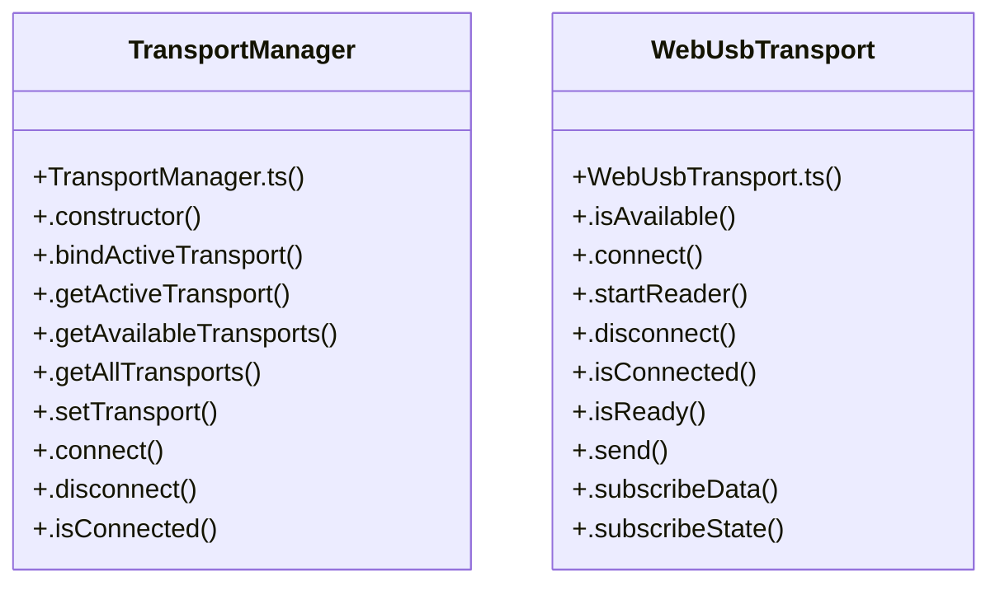

# Pixhawk Connection & Port Ca

> 92 nodes · cohesion 0.03

## Key Concepts

- [PixhawkConnectionCard.tsx](file:///C:/Antigravityyyyy/last%20drone/skycon/frontend/src/components/Drone/PixhawkConnectionCard.tsx#L1) (54 connections)
- [TransportManager](file:///C:/Antigravityyyyy/last%20drone/skycon/frontend/src/services/transports/TransportManager.ts#L11) (19 connections)
- [WebUsbTransport](file:///C:/Antigravityyyyy/last%20drone/skycon/frontend/src/services/transports/WebUsbTransport.ts#L3) (13 connections)
- [.connectHardware()](file:///C:/Antigravityyyyy/last%20drone/skycon/frontend/src/services/mavlinkService.ts#L898) (7 connections)
- [PixhawkMonitor.tsx](file:///C:/Antigravityyyyy/last%20drone/skycon/frontend/src/components/Drone/PixhawkMonitor.tsx#L1) (6 connections)
- [.connect()](file:///C:/Antigravityyyyy/last%20drone/skycon/frontend/src/services/transports/WebUsbTransport.ts#L20) (6 connections)
- [.bindActiveTransport()](file:///C:/Antigravityyyyy/last%20drone/skycon/frontend/src/services/transports/TransportManager.ts#L66) (5 connections)
- [.constructor()](file:///C:/Antigravityyyyy/last%20drone/skycon/frontend/src/services/mavlinkService.ts#L368) (4 connections)
- [.connectEsp32()](file:///C:/Antigravityyyyy/last%20drone/skycon/frontend/src/services/transports/TransportManager.ts#L144) (4 connections)
- [.setTransport()](file:///C:/Antigravityyyyy/last%20drone/skycon/frontend/src/services/transports/TransportManager.ts#L91) (4 connections)
- [handleScan()](file:///C:/Antigravityyyyy/last%20drone/skycon/frontend/src/components/Drone/PixhawkConnectionCard.tsx#L220) (3 connections)
- [.constructor()](file:///C:/Antigravityyyyy/last%20drone/skycon/frontend/src/services/transports/TransportManager.ts#L22) (3 connections)
- [.scanUsbDevices()](file:///C:/Antigravityyyyy/last%20drone/skycon/frontend/src/services/transports/TransportManager.ts#L122) (3 connections)
- [.disconnect()](file:///C:/Antigravityyyyy/last%20drone/skycon/frontend/src/services/transports/WebUsbTransport.ts#L111) (3 connections)
- [.isAvailable()](file:///C:/Antigravityyyyy/last%20drone/skycon/frontend/src/services/transports/WebUsbTransport.ts#L16) (3 connections)
- [.notifyState()](file:///C:/Antigravityyyyy/last%20drone/skycon/frontend/src/services/transports/WebUsbTransport.ts#L158) (3 connections)
- [.startReader()](file:///C:/Antigravityyyyy/last%20drone/skycon/frontend/src/services/transports/WebUsbTransport.ts#L95) (3 connections)
- [.subscribeState()](file:///C:/Antigravityyyyy/last%20drone/skycon/frontend/src/services/transports/WebUsbTransport.ts#L149) (3 connections)
- [handleBaudChange()](file:///C:/Antigravityyyyy/last%20drone/skycon/frontend/src/components/Drone/PixhawkConnectionCard.tsx#L309) (2 connections)
- [handleConfirmDisconnect()](file:///C:/Antigravityyyyy/last%20drone/skycon/frontend/src/components/Drone/PixhawkConnectionCard.tsx#L301) (2 connections)
- [handleConnectEsp32()](file:///C:/Antigravityyyyy/last%20drone/skycon/frontend/src/components/Drone/PixhawkConnectionCard.tsx#L244) (2 connections)
- [handleConnectUsb()](file:///C:/Antigravityyyyy/last%20drone/skycon/frontend/src/components/Drone/PixhawkConnectionCard.tsx#L230) (2 connections)
- [handleRequestPermission()](file:///C:/Antigravityyyyy/last%20drone/skycon/frontend/src/components/Drone/PixhawkConnectionCard.tsx#L292) (2 connections)
- [handleConnectSerial()](file:///C:/Antigravityyyyy/last%20drone/skycon/frontend/src/components/Drone/PixhawkMonitor.tsx#L19) (2 connections)
- [.connect()](file:///C:/Antigravityyyyy/last%20drone/skycon/frontend/src/services/transports/TransportManager.ts#L102) (2 connections)
- *... and 67 more nodes in this community*

## Class Diagram

## Relationships

- No strong cross-community connections detected

## Source Files

- [skycon\frontend\src\components\Drone\PixhawkConnectionCard.tsx](file:///C:/Antigravityyyyy/last%20drone/skycon/frontend/src/components/Drone/PixhawkConnectionCard.tsx)
- [skycon\frontend\src\components\Drone\PixhawkMonitor.tsx](file:///C:/Antigravityyyyy/last%20drone/skycon/frontend/src/components/Drone/PixhawkMonitor.tsx)
- [skycon\frontend\src\services\mavlinkService.ts](file:///C:/Antigravityyyyy/last%20drone/skycon/frontend/src/services/mavlinkService.ts)
- [skycon\frontend\src\services\transports\TransportManager.ts](file:///C:/Antigravityyyyy/last%20drone/skycon/frontend/src/services/transports/TransportManager.ts)
- [skycon\frontend\src\services\transports\WebUsbTransport.ts](file:///C:/Antigravityyyyy/last%20drone/skycon/frontend/src/services/transports/WebUsbTransport.ts)

## Audit Trail

- EXTRACTED: 206 (88%)
- INFERRED: 27 (12%)
- AMBIGUOUS: 0 (0%)

---

*Part of the graphify knowledge wiki. See [[index]] to navigate.*