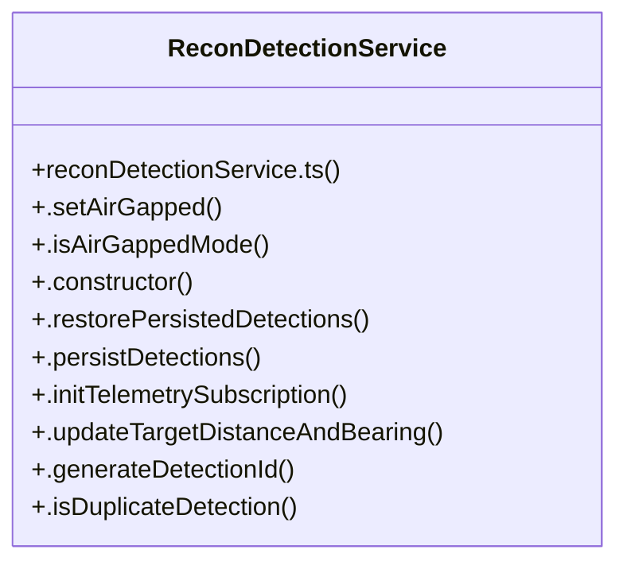

# Recon & Target QR Detection

> 69 nodes · cohesion 0.06

## Key Concepts

- [.getTelemetry()](file:///C:/Antigravityyyyy/last%20drone/skycon/frontend/src/services/mavlinkService.ts#L684) (40 connections)
- [ReconDetectionService](file:///C:/Antigravityyyyy/last%20drone/skycon/frontend/src/services/reconDetectionService.ts#L62) (30 connections)
- [.handleRawDetectionEvent()](file:///C:/Antigravityyyyy/last%20drone/skycon/frontend/src/services/reconDetectionService.ts#L212) (26 connections)
- [runReconTests()](file:///C:/Antigravityyyyy/last%20drone/skycon/tests/test-recon-system.ts#L51) (20 connections)
- [.subscribeTelemetry()](file:///C:/Antigravityyyyy/last%20drone/skycon/frontend/src/services/mavlinkService.ts#L667) (11 connections)
- [.triggerAutomaticRTL()](file:///C:/Antigravityyyyy/last%20drone/skycon/frontend/src/services/reconDetectionService.ts#L395) (11 connections)
- [.captureAndAnalyzePhoto()](file:///C:/Antigravityyyyy/last%20drone/skycon/frontend/src/services/visionService.ts#L593) (10 connections)
- [.scanLiveFrameEdgeToEdge()](file:///C:/Antigravityyyyy/last%20drone/skycon/frontend/src/services/visionService.ts#L407) (10 connections)
- [.retryRecordDecode()](file:///C:/Antigravityyyyy/last%20drone/skycon/frontend/src/services/reconDetectionService.ts#L558) (9 connections)
- [.reportDecodedQR()](file:///C:/Antigravityyyyy/last%20drone/skycon/frontend/src/services/visionService.ts#L750) (9 connections)
- [.triggerSimulatedDetection()](file:///C:/Antigravityyyyy/last%20drone/skycon/frontend/src/services/visionService.ts#L688) (9 connections)
- [calculateGeodesicDistance()](file:///C:/Antigravityyyyy/last%20drone/skycon/frontend/src/services/reconDetectionService.ts#L39) (8 connections)
- [qrDecoderService.ts](file:///C:/Antigravityyyyy/last%20drone/skycon/frontend/src/services/qrDecoderService.ts#L1) (8 connections)
- [.playQrDetected()](file:///C:/Antigravityyyyy/last%20drone/skycon/frontend/src/services/audioService.ts#L49) (7 connections)
- [classifyPayload()](file:///C:/Antigravityyyyy/last%20drone/skycon/frontend/src/services/qrDecoderService.ts#L153) (7 connections)
- [decodeQRFromImageData()](file:///C:/Antigravityyyyy/last%20drone/skycon/frontend/src/services/qrDecoderService.ts#L192) (7 connections)
- [.clearAllDetections()](file:///C:/Antigravityyyyy/last%20drone/skycon/frontend/src/services/reconDetectionService.ts#L613) (7 connections)
- [.requestTargetApproach()](file:///C:/Antigravityyyyy/last%20drone/skycon/frontend/src/services/reconDetectionService.ts#L486) (7 connections)
- [runTests()](file:///C:/Antigravityyyyy/last%20drone/skycon/tests/test-drone-core-simplification.ts#L46) (7 connections)
- [parseCoordinatesFromPayload()](file:///C:/Antigravityyyyy/last%20drone/skycon/frontend/src/services/qrDecoderService.ts#L70) (6 connections)
- [.persistDetections()](file:///C:/Antigravityyyyy/last%20drone/skycon/frontend/src/services/reconDetectionService.ts#L120) (6 connections)
- [test-drone-core-simplification.ts](file:///C:/Antigravityyyyy/last%20drone/skycon/tests/test-drone-core-simplification.ts#L1) (6 connections)
- [test-recon-system.ts](file:///C:/Antigravityyyyy/last%20drone/skycon/tests/test-recon-system.ts#L1) (6 connections)
- [calculateGeodesicBearing()](file:///C:/Antigravityyyyy/last%20drone/skycon/frontend/src/services/reconDetectionService.ts#L53) (5 connections)
- [.notifyDetectionListeners()](file:///C:/Antigravityyyyy/last%20drone/skycon/frontend/src/services/reconDetectionService.ts#L743) (5 connections)
- *... and 44 more nodes in this community*

## Class Diagram

## Relationships

- No strong cross-community connections detected

## Source Files

- [skycon\frontend\src\features\dashboard\CameraFeed.tsx](file:///C:/Antigravityyyyy/last%20drone/skycon/frontend/src/features/dashboard/CameraFeed.tsx)
- [skycon\frontend\src\services\audioService.ts](file:///C:/Antigravityyyyy/last%20drone/skycon/frontend/src/services/audioService.ts)
- [skycon\frontend\src\services\mavlinkService.ts](file:///C:/Antigravityyyyy/last%20drone/skycon/frontend/src/services/mavlinkService.ts)
- [skycon\frontend\src\services\qrDecoderService.ts](file:///C:/Antigravityyyyy/last%20drone/skycon/frontend/src/services/qrDecoderService.ts)
- [skycon\frontend\src\services\reconDetectionService.ts](file:///C:/Antigravityyyyy/last%20drone/skycon/frontend/src/services/reconDetectionService.ts)
- [skycon\frontend\src\services\visionService.ts](file:///C:/Antigravityyyyy/last%20drone/skycon/frontend/src/services/visionService.ts)
- [skycon\tests\test-drone-core-simplification.ts](file:///C:/Antigravityyyyy/last%20drone/skycon/tests/test-drone-core-simplification.ts)
- [skycon\tests\test-recon-system.ts](file:///C:/Antigravityyyyy/last%20drone/skycon/tests/test-recon-system.ts)

## Audit Trail

- EXTRACTED: 226 (60%)
- INFERRED: 152 (40%)
- AMBIGUOUS: 0 (0%)

---

*Part of the graphify knowledge wiki. See [[index]] to navigate.*