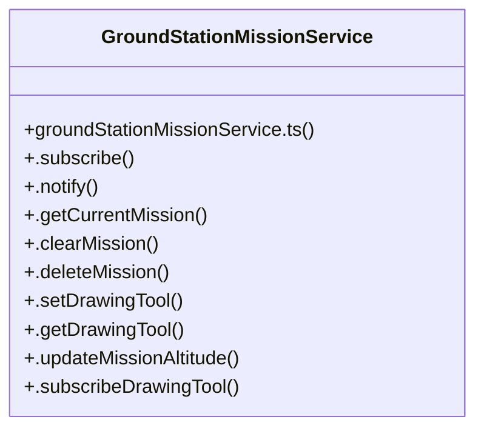

# Search Orbit & Grid Mission

> 86 nodes · cohesion 0.04

## Key Concepts

- [GroundStationMissionService](file:///C:/Antigravityyyyy/last%20drone/skycon/frontend/src/services/groundStationMissionService.ts#L119) (25 connections)
- [AutonomousMissionControlCard.tsx](file:///C:/Antigravityyyyy/last%20drone/skycon/frontend/src/features/dashboard/AutonomousMissionControlCard.tsx#L1) (23 connections)
- [handlePatternClick()](file:///C:/Antigravityyyyy/last%20drone/skycon/frontend/src/features/dashboard/MissionPatterns.tsx#L58) (13 connections)
- [calculateHaversineDistance()](file:///C:/Antigravityyyyy/last%20drone/skycon/frontend/src/services/groundStationMissionService.ts#L11) (12 connections)
- [.uploadMissionToDrone()](file:///C:/Antigravityyyyy/last%20drone/skycon/frontend/src/services/groundStationMissionService.ts#L1030) (12 connections)
- [WaypointManager.tsx](file:///C:/Antigravityyyyy/last%20drone/skycon/frontend/src/features/dashboard/WaypointManager.tsx#L1) (12 connections)
- [.notify()](file:///C:/Antigravityyyyy/last%20drone/skycon/frontend/src/services/groundStationMissionService.ts#L131) (11 connections)
- [.setCircleRadius()](file:///C:/Antigravityyyyy/last%20drone/skycon/frontend/src/services/groundStationMissionService.ts#L217) (9 connections)
- [.generateCircleMission()](file:///C:/Antigravityyyyy/last%20drone/skycon/frontend/src/services/groundStationMissionService.ts#L469) (8 connections)
- [.deleteMission()](file:///C:/Antigravityyyyy/last%20drone/skycon/frontend/src/services/groundStationMissionService.ts#L152) (7 connections)
- [handleMouseUpFinish()](file:///C:/Antigravityyyyy/last%20drone/skycon/frontend/src/features/dashboard/MapPanel.tsx#L330) (7 connections)
- [.clearMission()](file:///C:/Antigravityyyyy/last%20drone/skycon/frontend/src/services/groundStationMissionService.ts#L139) (6 connections)
- [.generateAutonomousSearchMission()](file:///C:/Antigravityyyyy/last%20drone/skycon/frontend/src/services/groundStationMissionService.ts#L705) (6 connections)
- [.generateConcentricCircleMission()](file:///C:/Antigravityyyyy/last%20drone/skycon/frontend/src/services/groundStationMissionService.ts#L581) (6 connections)
- [.generatePolygonGridMission()](file:///C:/Antigravityyyyy/last%20drone/skycon/frontend/src/services/groundStationMissionService.ts#L882) (6 connections)
- [.generateWaypointMission()](file:///C:/Antigravityyyyy/last%20drone/skycon/frontend/src/services/groundStationMissionService.ts#L272) (6 connections)
- [.getCurrentMission()](file:///C:/Antigravityyyyy/last%20drone/skycon/frontend/src/services/groundStationMissionService.ts#L135) (6 connections)
- [groundStationMissionService.ts](file:///C:/Antigravityyyyy/last%20drone/skycon/frontend/src/services/groundStationMissionService.ts#L1) (6 connections)
- [test-ground-station-layout.ts](file:///C:/Antigravityyyyy/last%20drone/skycon/tests/test-ground-station-layout.ts#L1) (6 connections)
- [runGroundStationTests()](file:///C:/Antigravityyyyy/last%20drone/skycon/tests/test-ground-station-layout.ts#L49) (6 connections)
- [handleDeleteWaypoint()](file:///C:/Antigravityyyyy/last%20drone/skycon/frontend/src/features/dashboard/WaypointManager.tsx#L87) (6 connections)
- [handleUploadWaypoints()](file:///C:/Antigravityyyyy/last%20drone/skycon/frontend/src/features/dashboard/DashboardPage.tsx#L390) (5 connections)
- [computeDestination()](file:///C:/Antigravityyyyy/last%20drone/skycon/frontend/src/services/groundStationMissionService.ts#L54) (5 connections)
- [regeneratePath()](file:///C:/Antigravityyyyy/last%20drone/skycon/frontend/src/features/dashboard/AutonomousMissionControlCard.tsx#L102) (4 connections)
- [handleMapClick()](file:///C:/Antigravityyyyy/last%20drone/skycon/frontend/src/components/GroundStation/GoogleMapGroundStation.tsx#L508) (4 connections)
- *... and 61 more nodes in this community*

## Class Diagram

## Relationships

- No strong cross-community connections detected

## Source Files

- [skycon\frontend\src\components\GroundStation\GoogleMapGroundStation.tsx](file:///C:/Antigravityyyyy/last%20drone/skycon/frontend/src/components/GroundStation/GoogleMapGroundStation.tsx)
- [skycon\frontend\src\features\dashboard\AutonomousMissionControlCard.tsx](file:///C:/Antigravityyyyy/last%20drone/skycon/frontend/src/features/dashboard/AutonomousMissionControlCard.tsx)
- [skycon\frontend\src\features\dashboard\DashboardPage.tsx](file:///C:/Antigravityyyyy/last%20drone/skycon/frontend/src/features/dashboard/DashboardPage.tsx)
- [skycon\frontend\src\features\dashboard\ManualMissionControlCard.tsx](file:///C:/Antigravityyyyy/last%20drone/skycon/frontend/src/features/dashboard/ManualMissionControlCard.tsx)
- [skycon\frontend\src\features\dashboard\MapPanel.tsx](file:///C:/Antigravityyyyy/last%20drone/skycon/frontend/src/features/dashboard/MapPanel.tsx)
- [skycon\frontend\src\features\dashboard\MissionPatterns.tsx](file:///C:/Antigravityyyyy/last%20drone/skycon/frontend/src/features/dashboard/MissionPatterns.tsx)
- [skycon\frontend\src\features\dashboard\WaypointManager.tsx](file:///C:/Antigravityyyyy/last%20drone/skycon/frontend/src/features/dashboard/WaypointManager.tsx)
- [skycon\frontend\src\services\groundStationMissionService.ts](file:///C:/Antigravityyyyy/last%20drone/skycon/frontend/src/services/groundStationMissionService.ts)
- [skycon\tests\test-ground-station-layout.ts](file:///C:/Antigravityyyyy/last%20drone/skycon/tests/test-ground-station-layout.ts)

## Audit Trail

- EXTRACTED: 224 (70%)
- INFERRED: 94 (30%)
- AMBIGUOUS: 0 (0%)

---

*Part of the graphify knowledge wiki. See [[index]] to navigate.*