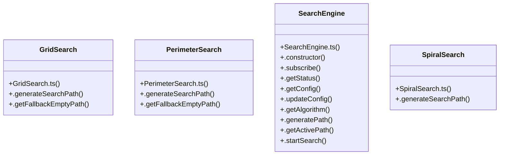

# Searchengine Subsystem

> 47 nodes · cohesion 0.08

## Key Concepts

- [SearchEngine](file:///C:/Antigravityyyyy/last%20drone/skycon/frontend/src/services/searchEngine/SearchEngine.ts#L48) (21 connections)
- [.notify()](file:///C:/Antigravityyyyy/last%20drone/skycon/frontend/src/services/searchEngine/SearchEngine.ts#L483) (13 connections)
- [calculateGroundCoverage()](file:///C:/Antigravityyyyy/last%20drone/skycon/frontend/src/services/searchEngine/BaseSearchAlgorithm.ts#L27) (9 connections)
- [.generateSearchPath()](file:///C:/Antigravityyyyy/last%20drone/skycon/frontend/src/services/searchEngine/PerimeterSearch.ts#L15) (9 connections)
- [.generatePath()](file:///C:/Antigravityyyyy/last%20drone/skycon/frontend/src/services/searchEngine/SearchEngine.ts#L179) (8 connections)
- [BaseSearchAlgorithm.ts](file:///C:/Antigravityyyyy/last%20drone/skycon/frontend/src/services/searchEngine/BaseSearchAlgorithm.ts#L1) (8 connections)
- [.generateSearchPath()](file:///C:/Antigravityyyyy/last%20drone/skycon/frontend/src/services/searchEngine/SpiralSearch.ts#L15) (8 connections)
- [.setupListeners()](file:///C:/Antigravityyyyy/last%20drone/skycon/frontend/src/services/eventLogService.ts#L105) (7 connections)
- [.generateSearchPath()](file:///C:/Antigravityyyyy/last%20drone/skycon/frontend/src/services/searchEngine/GridSearch.ts#L15) (7 connections)
- [.initListeners()](file:///C:/Antigravityyyyy/last%20drone/skycon/frontend/src/services/missionEngine.ts#L258) (7 connections)
- [.handlePotentialTargetDetected()](file:///C:/Antigravityyyyy/last%20drone/skycon/frontend/src/services/searchEngine/SearchEngine.ts#L354) (6 connections)
- [.updateConfig()](file:///C:/Antigravityyyyy/last%20drone/skycon/frontend/src/services/searchEngine/SearchEngine.ts#L144) (6 connections)
- [getDistanceMeters()](file:///C:/Antigravityyyyy/last%20drone/skycon/frontend/src/services/searchEngine/BaseSearchAlgorithm.ts#L87) (5 connections)
- [metersToLatLng()](file:///C:/Antigravityyyyy/last%20drone/skycon/frontend/src/services/searchEngine/BaseSearchAlgorithm.ts#L68) (5 connections)
- [.startSearch()](file:///C:/Antigravityyyyy/last%20drone/skycon/frontend/src/services/searchEngine/SearchEngine.ts#L211) (5 connections)
- [calculatePolygonAreaMeters()](file:///C:/Antigravityyyyy/last%20drone/skycon/frontend/src/services/searchEngine/BaseSearchAlgorithm.ts#L109) (4 connections)
- [.subscribeBox()](file:///C:/Antigravityyyyy/last%20drone/skycon/frontend/src/services/boxDetectionService.ts#L30) (4 connections)
- [render()](file:///C:/Antigravityyyyy/last%20drone/skycon/frontend/src/components/Mission/MissionMapDrawer.tsx#L172) (4 connections)
- [.getAlgorithm()](file:///C:/Antigravityyyyy/last%20drone/skycon/frontend/src/services/searchEngine/SearchEngine.ts#L172) (4 connections)
- [.getStatus()](file:///C:/Antigravityyyyy/last%20drone/skycon/frontend/src/services/searchEngine/SearchEngine.ts#L106) (4 connections)
- [.initVisionAndDetectionHooks()](file:///C:/Antigravityyyyy/last%20drone/skycon/frontend/src/services/searchEngine/SearchEngine.ts#L332) (4 connections)
- [.resumeSearch()](file:///C:/Antigravityyyyy/last%20drone/skycon/frontend/src/services/searchEngine/SearchEngine.ts#L259) (4 connections)
- [.subscribeQR()](file:///C:/Antigravityyyyy/last%20drone/skycon/frontend/src/services/visionService.ts#L111) (4 connections)
- [getPolygonCentroid()](file:///C:/Antigravityyyyy/last%20drone/skycon/frontend/src/services/searchEngine/BaseSearchAlgorithm.ts#L122) (3 connections)
- [latLngToMeters()](file:///C:/Antigravityyyyy/last%20drone/skycon/frontend/src/services/searchEngine/BaseSearchAlgorithm.ts#L78) (3 connections)
- *... and 22 more nodes in this community*

## Class Diagram

## Relationships

- No strong cross-community connections detected

## Source Files

- [skycon\frontend\src\components\Mission\MissionMapDrawer.tsx](file:///C:/Antigravityyyyy/last%20drone/skycon/frontend/src/components/Mission/MissionMapDrawer.tsx)
- [skycon\frontend\src\services\boxDetectionService.ts](file:///C:/Antigravityyyyy/last%20drone/skycon/frontend/src/services/boxDetectionService.ts)
- [skycon\frontend\src\services\eventLogService.ts](file:///C:/Antigravityyyyy/last%20drone/skycon/frontend/src/services/eventLogService.ts)
- [skycon\frontend\src\services\mavlinkService.ts](file:///C:/Antigravityyyyy/last%20drone/skycon/frontend/src/services/mavlinkService.ts)
- [skycon\frontend\src\services\missionEngine.ts](file:///C:/Antigravityyyyy/last%20drone/skycon/frontend/src/services/missionEngine.ts)
- [skycon\frontend\src\services\runnerCommService.ts](file:///C:/Antigravityyyyy/last%20drone/skycon/frontend/src/services/runnerCommService.ts)
- [skycon\frontend\src\services\searchEngine\BaseSearchAlgorithm.ts](file:///C:/Antigravityyyyy/last%20drone/skycon/frontend/src/services/searchEngine/BaseSearchAlgorithm.ts)
- [skycon\frontend\src\services\searchEngine\GridSearch.ts](file:///C:/Antigravityyyyy/last%20drone/skycon/frontend/src/services/searchEngine/GridSearch.ts)
- [skycon\frontend\src\services\searchEngine\PerimeterSearch.ts](file:///C:/Antigravityyyyy/last%20drone/skycon/frontend/src/services/searchEngine/PerimeterSearch.ts)
- [skycon\frontend\src\services\searchEngine\SearchEngine.ts](file:///C:/Antigravityyyyy/last%20drone/skycon/frontend/src/services/searchEngine/SearchEngine.ts)
- [skycon\frontend\src\services\searchEngine\SpiralSearch.ts](file:///C:/Antigravityyyyy/last%20drone/skycon/frontend/src/services/searchEngine/SpiralSearch.ts)
- [skycon\frontend\src\services\visionService.ts](file:///C:/Antigravityyyyy/last%20drone/skycon/frontend/src/services/visionService.ts)

## Audit Trail

- EXTRACTED: 126 (60%)
- INFERRED: 84 (40%)
- AMBIGUOUS: 0 (0%)

---

*Part of the graphify knowledge wiki. See [[index]] to navigate.*