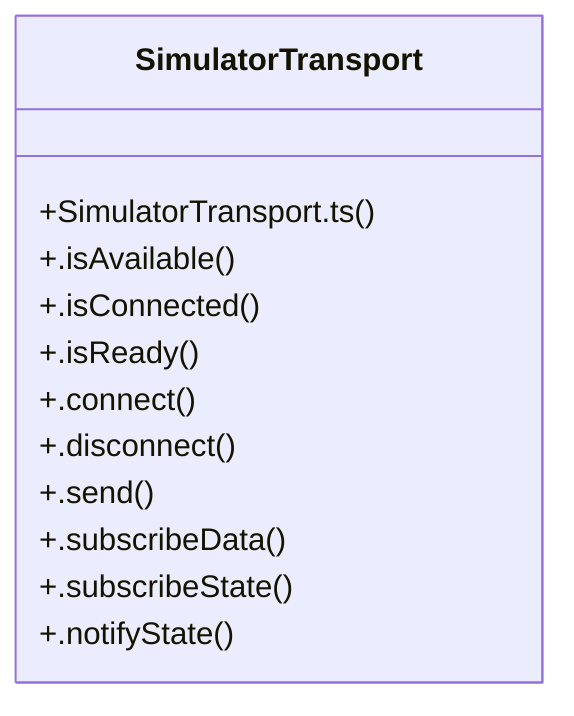

# Simulatortransport Subsystem

> 12 nodes · cohesion 0.20

## Key Concepts

- [SimulatorTransport](file:///C:/Antigravityyyyy/last%20drone/skycon/frontend/src/services/transports/SimulatorTransport.ts#L3) (11 connections)
- [.notifyState()](file:///C:/Antigravityyyyy/last%20drone/skycon/frontend/src/services/transports/SimulatorTransport.ts#L60) (3 connections)
- [.connect()](file:///C:/Antigravityyyyy/last%20drone/skycon/frontend/src/services/transports/SimulatorTransport.ts#L24) (2 connections)
- [.disconnect()](file:///C:/Antigravityyyyy/last%20drone/skycon/frontend/src/services/transports/SimulatorTransport.ts#L38) (2 connections)
- [.getDiagnostics()](file:///C:/Antigravityyyyy/last%20drone/skycon/frontend/src/services/transports/SimulatorTransport.ts#L64) (1 connections)
- [.isAvailable()](file:///C:/Antigravityyyyy/last%20drone/skycon/frontend/src/services/transports/SimulatorTransport.ts#L12) (1 connections)
- [.isConnected()](file:///C:/Antigravityyyyy/last%20drone/skycon/frontend/src/services/transports/SimulatorTransport.ts#L16) (1 connections)
- [.isReady()](file:///C:/Antigravityyyyy/last%20drone/skycon/frontend/src/services/transports/SimulatorTransport.ts#L20) (1 connections)
- [.send()](file:///C:/Antigravityyyyy/last%20drone/skycon/frontend/src/services/transports/SimulatorTransport.ts#L46) (1 connections)
- [.subscribeData()](file:///C:/Antigravityyyyy/last%20drone/skycon/frontend/src/services/transports/SimulatorTransport.ts#L50) (1 connections)
- [.subscribeState()](file:///C:/Antigravityyyyy/last%20drone/skycon/frontend/src/services/transports/SimulatorTransport.ts#L55) (1 connections)
- [SimulatorTransport.ts](file:///C:/Antigravityyyyy/last%20drone/skycon/frontend/src/services/transports/SimulatorTransport.ts#L1) (1 connections)

## Class Diagram

## Relationships

- No strong cross-community connections detected

## Source Files

- [skycon\frontend\src\services\transports\SimulatorTransport.ts](file:///C:/Antigravityyyyy/last%20drone/skycon/frontend/src/services/transports/SimulatorTransport.ts)

## Audit Trail

- EXTRACTED: 26 (100%)
- INFERRED: 0 (0%)
- AMBIGUOUS: 0 (0%)

---

*Part of the graphify knowledge wiki. See [[index]] to navigate.*