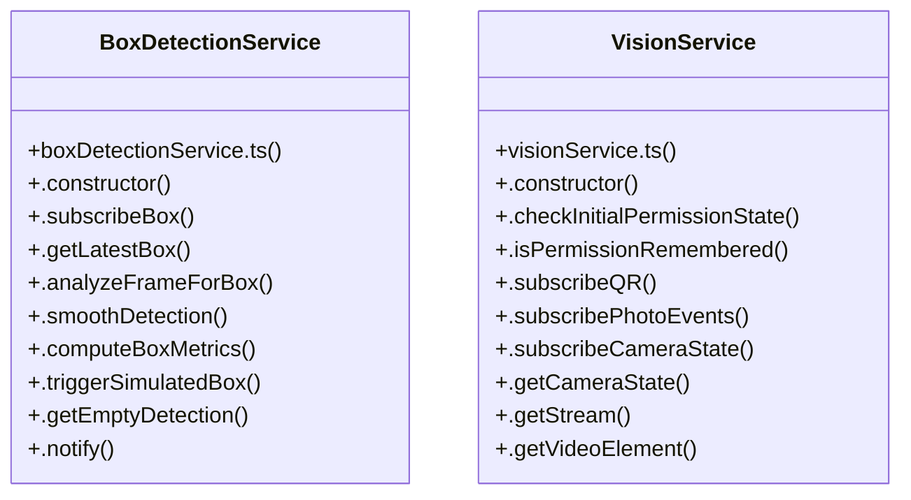

# Target Box Geometric Detecti

> 65 nodes · cohesion 0.05

## Key Concepts

- [VisionService](file:///C:/Antigravityyyyy/last%20drone/skycon/frontend/src/services/visionService.ts#L29) (40 connections)
- [CameraVisionHUD.tsx](file:///C:/Antigravityyyyy/last%20drone/skycon/frontend/src/components/Drone/CameraVisionHUD.tsx#L1) (21 connections)
- [.getCameraState()](file:///C:/Antigravityyyyy/last%20drone/skycon/frontend/src/services/visionService.ts#L131) (12 connections)
- [BoxDetectionService](file:///C:/Antigravityyyyy/last%20drone/skycon/frontend/src/services/boxDetectionService.ts#L10) (11 connections)
- [.notifyCameraState()](file:///C:/Antigravityyyyy/last%20drone/skycon/frontend/src/services/visionService.ts#L881) (7 connections)
- [.startCamera()](file:///C:/Antigravityyyyy/last%20drone/skycon/frontend/src/services/visionService.ts#L217) (7 connections)
- [.analyzeFrameForBox()](file:///C:/Antigravityyyyy/last%20drone/skycon/frontend/src/services/boxDetectionService.ts#L44) (6 connections)
- [.handleInspectionQRNotFound()](file:///C:/Antigravityyyyy/last%20drone/skycon/frontend/src/services/searchEngine/SearchEngine.ts#L444) (5 connections)
- [Target Box Acquisition & 2-Digit QR Pipeline](file:///C:/Antigravityyyyy/last%20drone/skycon/.agents/rules/computer-vision-and-qr.md) (5 connections)
- [.setAutoZoom()](file:///C:/Antigravityyyyy/last%20drone/skycon/frontend/src/services/visionService.ts#L168) (5 connections)
- [.setHardwareZoom()](file:///C:/Antigravityyyyy/last%20drone/skycon/frontend/src/services/visionService.ts#L173) (5 connections)
- [.triggerSimulatedBox()](file:///C:/Antigravityyyyy/last%20drone/skycon/frontend/src/services/boxDetectionService.ts#L369) (4 connections)
- [handleSetDirectZoom()](file:///C:/Antigravityyyyy/last%20drone/skycon/frontend/src/components/Drone/CameraVisionHUD.tsx#L162) (4 connections)
- [.stopCamera()](file:///C:/Antigravityyyyy/last%20drone/skycon/frontend/src/services/visionService.ts#L369) (4 connections)
- [.computeBoxMetrics()](file:///C:/Antigravityyyyy/last%20drone/skycon/frontend/src/services/boxDetectionService.ts#L283) (3 connections)
- [.notify()](file:///C:/Antigravityyyyy/last%20drone/skycon/frontend/src/services/boxDetectionService.ts#L425) (3 connections)
- [.smoothDetection()](file:///C:/Antigravityyyyy/last%20drone/skycon/frontend/src/services/boxDetectionService.ts#L266) (3 connections)
- [handleSwitchCamera()](file:///C:/Antigravityyyyy/last%20drone/skycon/frontend/src/components/Drone/CameraVisionHUD.tsx#L146) (3 connections)
- [handleToggleAutoZoom()](file:///C:/Antigravityyyyy/last%20drone/skycon/frontend/src/components/Drone/CameraVisionHUD.tsx#L156) (3 connections)
- [handleToggleTorch()](file:///C:/Antigravityyyyy/last%20drone/skycon/frontend/src/components/Drone/CameraVisionHUD.tsx#L151) (3 connections)
- [handleTurnScannerOff()](file:///C:/Antigravityyyyy/last%20drone/skycon/frontend/src/components/Drone/CameraVisionHUD.tsx#L86) (3 connections)
- [handleTurnScannerOn()](file:///C:/Antigravityyyyy/last%20drone/skycon/frontend/src/components/Drone/CameraVisionHUD.tsx#L77) (3 connections)
- [startCameraStream()](file:///C:/Antigravityyyyy/last%20drone/skycon/frontend/src/components/Drone/CameraVisionHUD.tsx#L93) (3 connections)
- [visionService.ts](file:///C:/Antigravityyyyy/last%20drone/skycon/frontend/src/services/visionService.ts#L1) (3 connections)
- [.restartTimers()](file:///C:/Antigravityyyyy/last%20drone/skycon/frontend/src/services/visionService.ts#L555) (3 connections)
- *... and 40 more nodes in this community*

## Class Diagram

## Relationships

- No strong cross-community connections detected

## Source Files

- [skycon\.agents\rules\computer-vision-and-qr.md](file:///C:/Antigravityyyyy/last%20drone/skycon/.agents/rules/computer-vision-and-qr.md)
- [skycon\frontend\src\components\Drone\CameraVisionHUD.tsx](file:///C:/Antigravityyyyy/last%20drone/skycon/frontend/src/components/Drone/CameraVisionHUD.tsx)
- [skycon\frontend\src\services\boxDetectionService.ts](file:///C:/Antigravityyyyy/last%20drone/skycon/frontend/src/services/boxDetectionService.ts)
- [skycon\frontend\src\services\searchEngine\SearchEngine.ts](file:///C:/Antigravityyyyy/last%20drone/skycon/frontend/src/services/searchEngine/SearchEngine.ts)
- [skycon\frontend\src\services\visionService.ts](file:///C:/Antigravityyyyy/last%20drone/skycon/frontend/src/services/visionService.ts)

## Audit Trail

- EXTRACTED: 174 (76%)
- INFERRED: 54 (24%)
- AMBIGUOUS: 0 (0%)

---

*Part of the graphify knowledge wiki. See [[index]] to navigate.*