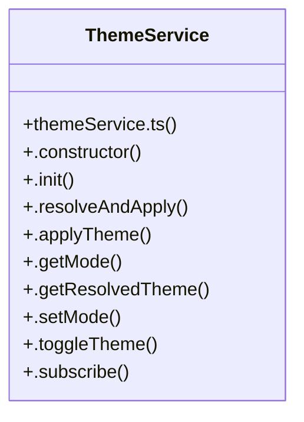

# Themeservice Subsystem

> 16 nodes · cohesion 0.18

## Key Concepts

- [ThemeService](file:///C:/Antigravityyyyy/last%20drone/skycon/frontend/src/services/themeService.ts#L7) (11 connections)
- [.resolveAndApply()](file:///C:/Antigravityyyyy/last%20drone/skycon/frontend/src/services/themeService.ts#L41) (4 connections)
- [ThemeController()](file:///C:/Antigravityyyyy/last%20drone/skycon/frontend/src/components/common/ThemeController.tsx#L10) (3 connections)
- [.applyTheme()](file:///C:/Antigravityyyyy/last%20drone/skycon/frontend/src/services/themeService.ts#L52) (3 connections)
- [.init()](file:///C:/Antigravityyyyy/last%20drone/skycon/frontend/src/services/themeService.ts#L17) (3 connections)
- [.setMode()](file:///C:/Antigravityyyyy/last%20drone/skycon/frontend/src/services/themeService.ts#L81) (3 connections)
- [ThemeController.tsx](file:///C:/Antigravityyyyy/last%20drone/skycon/frontend/src/components/common/ThemeController.tsx#L1) (2 connections)
- [themeService.ts](file:///C:/Antigravityyyyy/last%20drone/skycon/frontend/src/services/themeService.ts#L1) (2 connections)
- [.constructor()](file:///C:/Antigravityyyyy/last%20drone/skycon/frontend/src/services/themeService.ts#L13) (2 connections)
- [.getMode()](file:///C:/Antigravityyyyy/last%20drone/skycon/frontend/src/services/themeService.ts#L73) (2 connections)
- [.getResolvedTheme()](file:///C:/Antigravityyyyy/last%20drone/skycon/frontend/src/services/themeService.ts#L77) (2 connections)
- [.notifyListeners()](file:///C:/Antigravityyyyy/last%20drone/skycon/frontend/src/services/themeService.ts#L108) (2 connections)
- [.toggleTheme()](file:///C:/Antigravityyyyy/last%20drone/skycon/frontend/src/services/themeService.ts#L91) (2 connections)
- [currentIcon()](file:///C:/Antigravityyyyy/last%20drone/skycon/frontend/src/components/common/ThemeController.tsx#L64) (1 connections)
- [THEME_STORAGE_KEY](file:///C:/Antigravityyyyy/last%20drone/skycon/frontend/src/services/themeService.ts#L5) (1 connections)
- [.subscribe()](file:///C:/Antigravityyyyy/last%20drone/skycon/frontend/src/services/themeService.ts#L102) (1 connections)

## Class Diagram

## Relationships

- No strong cross-community connections detected

## Source Files

- [skycon\frontend\src\components\common\ThemeController.tsx](file:///C:/Antigravityyyyy/last%20drone/skycon/frontend/src/components/common/ThemeController.tsx)
- [skycon\frontend\src\services\themeService.ts](file:///C:/Antigravityyyyy/last%20drone/skycon/frontend/src/services/themeService.ts)

## Audit Trail

- EXTRACTED: 40 (91%)
- INFERRED: 4 (9%)
- AMBIGUOUS: 0 (0%)

---

*Part of the graphify knowledge wiki. See [[index]] to navigate.*