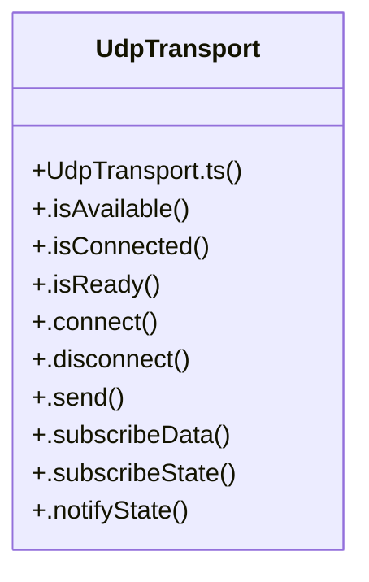

# Udptransport Subsystem

> 12 nodes · cohesion 0.20

## Key Concepts

- [UdpTransport](file:///C:/Antigravityyyyy/last%20drone/skycon/frontend/src/services/transports/UdpTransport.ts#L3) (11 connections)
- [.notifyState()](file:///C:/Antigravityyyyy/last%20drone/skycon/frontend/src/services/transports/UdpTransport.ts#L69) (3 connections)
- [.connect()](file:///C:/Antigravityyyyy/last%20drone/skycon/frontend/src/services/transports/UdpTransport.ts#L26) (2 connections)
- [.disconnect()](file:///C:/Antigravityyyyy/last%20drone/skycon/frontend/src/services/transports/UdpTransport.ts#L47) (2 connections)
- [UdpTransport.ts](file:///C:/Antigravityyyyy/last%20drone/skycon/frontend/src/services/transports/UdpTransport.ts#L1) (1 connections)
- [.getDiagnostics()](file:///C:/Antigravityyyyy/last%20drone/skycon/frontend/src/services/transports/UdpTransport.ts#L73) (1 connections)
- [.isAvailable()](file:///C:/Antigravityyyyy/last%20drone/skycon/frontend/src/services/transports/UdpTransport.ts#L14) (1 connections)
- [.isConnected()](file:///C:/Antigravityyyyy/last%20drone/skycon/frontend/src/services/transports/UdpTransport.ts#L18) (1 connections)
- [.isReady()](file:///C:/Antigravityyyyy/last%20drone/skycon/frontend/src/services/transports/UdpTransport.ts#L22) (1 connections)
- [.send()](file:///C:/Antigravityyyyy/last%20drone/skycon/frontend/src/services/transports/UdpTransport.ts#L55) (1 connections)
- [.subscribeData()](file:///C:/Antigravityyyyy/last%20drone/skycon/frontend/src/services/transports/UdpTransport.ts#L59) (1 connections)
- [.subscribeState()](file:///C:/Antigravityyyyy/last%20drone/skycon/frontend/src/services/transports/UdpTransport.ts#L64) (1 connections)

## Class Diagram

## Relationships

- No strong cross-community connections detected

## Source Files

- [skycon\frontend\src\services\transports\UdpTransport.ts](file:///C:/Antigravityyyyy/last%20drone/skycon/frontend/src/services/transports/UdpTransport.ts)

## Audit Trail

- EXTRACTED: 26 (100%)
- INFERRED: 0 (0%)
- AMBIGUOUS: 0 (0%)

---

*Part of the graphify knowledge wiki. See [[index]] to navigate.*