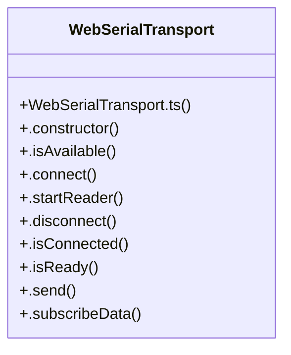

# Webserialtransport Subsystem

> 15 nodes · cohesion 0.21

## Key Concepts

- [WebSerialTransport](file:///C:/Antigravityyyyy/last%20drone/skycon/frontend/src/services/transports/WebSerialTransport.ts#L3) (14 connections)
- [.connect()](file:///C:/Antigravityyyyy/last%20drone/skycon/frontend/src/services/transports/WebSerialTransport.ts#L39) (4 connections)
- [.isAvailable()](file:///C:/Antigravityyyyy/last%20drone/skycon/frontend/src/services/transports/WebSerialTransport.ts#L35) (3 connections)
- [.isReady()](file:///C:/Antigravityyyyy/last%20drone/skycon/frontend/src/services/transports/WebSerialTransport.ts#L153) (3 connections)
- [.notifyState()](file:///C:/Antigravityyyyy/last%20drone/skycon/frontend/src/services/transports/WebSerialTransport.ts#L182) (3 connections)
- [.startReader()](file:///C:/Antigravityyyyy/last%20drone/skycon/frontend/src/services/transports/WebSerialTransport.ts#L99) (3 connections)
- [.constructor()](file:///C:/Antigravityyyyy/last%20drone/skycon/frontend/src/services/transports/WebSerialTransport.ts#L17) (2 connections)
- [.disconnect()](file:///C:/Antigravityyyyy/last%20drone/skycon/frontend/src/services/transports/WebSerialTransport.ts#L122) (2 connections)
- [.isConnected()](file:///C:/Antigravityyyyy/last%20drone/skycon/frontend/src/services/transports/WebSerialTransport.ts#L149) (2 connections)
- [.notifyData()](file:///C:/Antigravityyyyy/last%20drone/skycon/frontend/src/services/transports/WebSerialTransport.ts#L178) (2 connections)
- [.send()](file:///C:/Antigravityyyyy/last%20drone/skycon/frontend/src/services/transports/WebSerialTransport.ts#L157) (2 connections)
- [WebSerialTransport.ts](file:///C:/Antigravityyyyy/last%20drone/skycon/frontend/src/services/transports/WebSerialTransport.ts#L1) (1 connections)
- [.getDiagnostics()](file:///C:/Antigravityyyyy/last%20drone/skycon/frontend/src/services/transports/WebSerialTransport.ts#L186) (1 connections)
- [.subscribeData()](file:///C:/Antigravityyyyy/last%20drone/skycon/frontend/src/services/transports/WebSerialTransport.ts#L168) (1 connections)
- [.subscribeState()](file:///C:/Antigravityyyyy/last%20drone/skycon/frontend/src/services/transports/WebSerialTransport.ts#L173) (1 connections)

## Class Diagram

## Relationships

- No strong cross-community connections detected

## Source Files

- [skycon\frontend\src\services\transports\WebSerialTransport.ts](file:///C:/Antigravityyyyy/last%20drone/skycon/frontend/src/services/transports/WebSerialTransport.ts)

## Audit Trail

- EXTRACTED: 44 (100%)
- INFERRED: 0 (0%)
- AMBIGUOUS: 0 (0%)

---

*Part of the graphify knowledge wiki. See [[index]] to navigate.*