# Knowledge Graph Index

> Auto-generated by graphify. Start here — read community articles for context, then drill into god nodes for detail.

**2183 nodes · 3560 edges · 100 communities**

---

## System Architecture Flowchart

```mermaid
flowchart TD
    C0["Autonomous Mission Controls (133 nodes)"]
    C1["MAVLink Protocol & Telemetry (125 nodes)"]
    C2["Map Rendering & Telemetry Ma (109 nodes)"]
    C3["Audio & Haptic Alert Service (102 nodes)"]
    C4["Autonomous Mission Engine Li (101 nodes)"]
    C5["Ground Station Map & Geofenc (96 nodes)"]
    C6["Pixhawk Connection & Port Ca (92 nodes)"]
    C7["Search Orbit & Grid Mission (86 nodes)"]
    C8["Backend WebSocket Relay Serv (76 nodes)"]
    C9["Recon & Target QR Detection (69 nodes)"]
    C10["Autonomous Edge Core Servoin (66 nodes)"]
    C11["Target Box Geometric Detecti (65 nodes)"]
    C12["ESP32-S3 Wireless Telemetry (61 nodes)"]
    C13["HUD Telemetry Deck & Failsaf (61 nodes)"]
    C14["Custom Route & Waypoint Plan (58 nodes)"]
    C15["Android USB Serial OTG (53 nodes)"]
    C16["Header Subsystem (52 nodes)"]
    C17["Searchengine Subsystem (47 nodes)"]
    C18["Geofenceservice Subsystem (46 nodes)"]
    C19["Camerafeed Subsystem (44 nodes)"]
    C20["P2P Field Runner Link (40 nodes)"]
    C21["Ipcameraservice Subsystem (36 nodes)"]
    C22["Dronecamerastreamser (35 nodes)"]
    C23["Groundstationdashboa (32 nodes)"]
    C24["Preflightvalidationm (32 nodes)"]
    C25["Prearmdropdowncard Subsystem (31 nodes)"]
    C26["Missionhistorymodal Subsyste (29 nodes)"]
    C27["Map Rendering & MissionMapDr (28 nodes)"]
    C28["Test Transport Conne (25 nodes)"]
    C29["Manualcontroldashboa (21 nodes)"]
    C30["Cockpitinstrumentspa (16 nodes)"]
    C31["Themeservice Subsystem (16 nodes)"]
    C32["Webserialtransport Subsystem (15 nodes)"]
    C33["Flightcontrollercard (13 nodes)"]
    C34["Android USB Serial OTG (13 nodes)"]
    C35["Test Gps Accuracy Subsystem (13 nodes)"]
    C36["Instrumentcolumn Subsystem (12 nodes)"]
    C37["Android USB Serial OTG (12 nodes)"]
    C38["Simulatortransport Subsystem (12 nodes)"]
    C39["Udptransport Subsystem (12 nodes)"]
    C40["Missionstatus Subsystem (11 nodes)"]
    C41["Waypoint & Route Planning (10 nodes)"]
    C42["Flightoperationscard (9 nodes)"]
    C43["Connectionstatusdeck (8 nodes)"]
    C44["Controlmodepanel Subsystem (8 nodes)"]
    C45["Test Integration Ver (8 nodes)"]
    C46["Groundstationoperati (7 nodes)"]
    C47["Statrow Subsystem (7 nodes)"]
    C48["Missionstatuscard Subsystem (6 nodes)"]
    C49["Circle & Loiter Tuning (6 nodes)"]
    C50["Loitertestpanel Subsystem (6 nodes)"]
    C51["Adaptivesearch Subsystem (6 nodes)"]
    C52["Sync Dist Subsystem (6 nodes)"]
    C53["Collapsibleeventlog Subsyste (5 nodes)"]
    C54["Homepointsetter Subsystem (5 nodes)"]
    C55["Trafficviewradar Subsystem (5 nodes)"]
    C56["Loitertestmissioncar (5 nodes)"]
    C57["Multirolesimbench Subsystem (5 nodes)"]
    C58["Android USB Serial OTG (3 nodes)"]
    C59["Android USB Serial OTG (3 nodes)"]
    C60["Disarmsafetyconfirmm (3 nodes)"]
    C61["Returnbehaviorcard Subsystem (3 nodes)"]
    C62["Vehiclefleetlist Subsystem (3 nodes)"]
    C63["Telemetrypanel Subsystem (3 nodes)"]
    C64["Numberfield Subsystem (3 nodes)"]
    C65["Vite.Config Subsystem (2 nodes)"]
    C66["Batterymonitorcard Subsystem (2 nodes)"]
    C67["Android USB Serial OTG (2 nodes)"]
    C68["Telemetryhud Subsystem (2 nodes)"]
    C69["Computer Vision & QRResultCa (2 nodes)"]
    C70["Serialdiagnosticsmod (2 nodes)"]
    C71["Missionsafetycard Subsystem (2 nodes)"]
    C72["Preflightchecklist Subsystem (2 nodes)"]
    C73["Tacticalcommandrail Subsyste (2 nodes)"]
    C74["Map Rendering & TacticalMap (2 nodes)"]
    C75["Tacticalsidestack Subsystem (2 nodes)"]
    C76["Computer Vision & VisionStat (2 nodes)"]
    C77["P2P Field Runner Link (2 nodes)"]
    C78["Flightlogsdeck Subsystem (2 nodes)"]
    C79["Recondetectionpanel Subsyste (2 nodes)"]
    C80["Iconbutton Subsystem (2 nodes)"]
    C81["Segmented Subsystem (2 nodes)"]
    C82["Stattile Subsystem (2 nodes)"]
    C83["Toggle Subsystem (2 nodes)"]
    C84["Postcss.Config Subsystem (1 nodes)"]
    C85["Tailwind.Config Subsystem (1 nodes)"]
    C86["Main Subsystem (1 nodes)"]
    C87["Vite Env.D Subsystem (1 nodes)"]
    C88["Index Subsystem (1 nodes)"]
    C89["Types Subsystem (1 nodes)"]
    C90["Circle & Loiter Tuning (1 nodes)"]
    C91["Map Rendering & groundStatio (1 nodes)"]
    C92["Loitertest Subsystem (1 nodes)"]
    C93["MAVLink Protocol & mavlink (1 nodes)"]
    C94["Mission Subsystem (1 nodes)"]
    C95["Recon Subsystem (1 nodes)"]
    C96["P2P Field Runner Link (1 nodes)"]
    C97["Transport Subsystem (1 nodes)"]
    C98["Card Subsystem (1 nodes)"]
    C99["Readme Subsystem (1 nodes)"]
    C3 -->|27 edges| C1
    C3 -->|16 edges| C4
    C0 -->|16 edges| C1
    C1 -->|14 edges| C4
    C5 -->|11 edges| C3
    C1 -->|11 edges| C12
    C7 -->|10 edges| C4
    C7 -->|10 edges| C1
    C3 -->|10 edges| C9
    C11 -->|10 edges| C9
    C7 -->|8 edges| C3
    C0 -->|8 edges| C4
    C4 -->|8 edges| C9
    C4 -->|8 edges| C17
    C3 -->|8 edges| C0
    C0 -->|7 edges| C3
    C1 -->|7 edges| C9
    C9 -->|7 edges| C4
    C23 -->|6 edges| C1
    C10 -->|6 edges| C9
    C3 -->|5 edges| C7
    C3 -->|5 edges| C17
    C14 -->|5 edges| C1
    C6 -->|5 edges| C1
    C9 -->|5 edges| C10
    C28 -->|5 edges| C1
    C13 -->|4 edges| C4
    C10 -->|4 edges| C11
    C1 -->|4 edges| C3
    C0 -->|4 edges| C14
    C26 -->|4 edges| C4
    C19 -->|4 edges| C9
    C2 -->|4 edges| C4
    C7 -->|4 edges| C9
    C3 -->|4 edges| C18
    C11 -->|4 edges| C17
    C1 -->|4 edges| C6
    C9 -->|4 edges| C1
    C16 -->|4 edges| C1
    C9 -->|4 edges| C15
    C33 -->|3 edges| C1
    C5 -->|3 edges| C7
    C4 -->|3 edges| C3
    C2 -->|3 edges| C7
    C2 -->|3 edges| C3
    C4 -->|3 edges| C7
    C4 -->|3 edges| C1
    C3 -->|3 edges| C14
    C4 -->|3 edges| C20
    C14 -->|3 edges| C7
    C18 -->|3 edges| C9
    C0 -->|3 edges| C9
    C12 -->|3 edges| C1
    C1 -->|3 edges| C17
    C1 -->|3 edges| C35
    C18 -->|2 edges| C3
    C23 -->|2 edges| C3
    C20 -->|2 edges| C1
    C29 -->|2 edges| C1
    C4 -->|2 edges| C0
    C27 -->|2 edges| C4
    C17 -->|2 edges| C4
    C19 -->|2 edges| C3
    C1 -->|2 edges| C18
    C1 -->|2 edges| C7
    C4 -->|2 edges| C14
    C3 -->|2 edges| C20
    C3 -->|2 edges| C10
    C20 -->|2 edges| C4
    C10 -->|2 edges| C1
    C14 -->|2 edges| C4
    C22 -->|2 edges| C10
    C14 -->|2 edges| C17
    C17 -->|2 edges| C9
    C16 -->|2 edges| C9
    C1 -->|2 edges| C16
    C9 -->|2 edges| C17
    C16 -->|2 edges| C4
    C1 -->|2 edges| C10
    C1 -->|2 edges| C8
    C12 -->|2 edges| C0
    C15 -->|1 edges| C12
    C15 -->|1 edges| C16
    C8 -->|1 edges| C12
    C13 -->|1 edges| C9
    C44 -->|1 edges| C1
    C10 -->|1 edges| C4
    C6 -->|1 edges| C12
    C18 -->|1 edges| C17
    C23 -->|1 edges| C20
    C20 -->|1 edges| C3
    C23 -->|1 edges| C4
    C14 -->|1 edges| C3
    C0 -->|1 edges| C7
    C34 -->|1 edges| C4
    C0 -->|1 edges| C20
    C27 -->|1 edges| C17
    C27 -->|1 edges| C7
    C2 -->|1 edges| C5
    C2 -->|1 edges| C15
    C4 -->|1 edges| C2
    C2 -->|1 edges| C20
    C2 -->|1 edges| C18
    C24 -->|1 edges| C4
    C3 -->|1 edges| C6
    C3 -->|1 edges| C16
    C3 -->|1 edges| C11
    C9 -->|1 edges| C3
    C20 -->|1 edges| C9
    C4 -->|1 edges| C18
    C11 -->|1 edges| C1
    C14 -->|1 edges| C0
    C14 -->|1 edges| C9
    C14 -->|1 edges| C10
    C4 -->|1 edges| C16
    C1 -->|1 edges| C14
    C22 -->|1 edges| C8
    C17 -->|1 edges| C16
    C17 -->|1 edges| C6
    C18 -->|1 edges| C4
    C18 -->|1 edges| C1
    C21 -->|1 edges| C5
    C9 -->|1 edges| C35
    C9 -->|1 edges| C7
    C6 -->|1 edges| C16
    C1 -->|1 edges| C0
    C4 -->|1 edges| C12
    C4 -->|1 edges| C10
    C4 -->|1 edges| C11
    C9 -->|1 edges| C20
    C20 -->|1 edges| C17
    C16 -->|1 edges| C15
    C11 -->|1 edges| C15
    C17 -->|1 edges| C0
    C17 -->|1 edges| C11
    C17 -->|1 edges| C1
    C15 -->|1 edges| C6
    C0 -->|1 edges| C12
    C6 -->|1 edges| C8
    C8 -->|1 edges| C28
    C20 -->|1 edges| C11
```

## Communities
(sorted by size, largest first)

- [[Autonomous Mission Controls]] — 133 nodes
- [[MAVLink Protocol & Telemetry]] — 125 nodes
- [[Map Rendering & Telemetry Ma]] — 109 nodes
- [[Audio & Haptic Alert Service]] — 102 nodes
- [[Autonomous Mission Engine Li]] — 101 nodes
- [[Ground Station Map & Geofenc]] — 96 nodes
- [[Pixhawk Connection & Port Ca]] — 92 nodes
- [[Search Orbit & Grid Mission]] — 86 nodes
- [[Backend WebSocket Relay Serv]] — 76 nodes
- [[Recon & Target QR Detection]] — 69 nodes
- [[Autonomous Edge Core Servoin]] — 66 nodes
- [[Target Box Geometric Detecti]] — 65 nodes
- [[ESP32-S3 Wireless Telemetry]] — 61 nodes
- [[HUD Telemetry Deck & Failsaf]] — 61 nodes
- [[Custom Route & Waypoint Plan]] — 58 nodes
- [[Android USB Serial OTG]] — 53 nodes
- [[Header Subsystem]] — 52 nodes
- [[Searchengine Subsystem]] — 47 nodes
- [[Geofenceservice Subsystem]] — 46 nodes
- [[Camerafeed Subsystem]] — 44 nodes
- [[P2P Field Runner Link]] — 40 nodes
- [[Ipcameraservice Subsystem]] — 36 nodes
- [[Dronecamerastreamser]] — 35 nodes
- [[Groundstationdashboa]] — 32 nodes
- [[Preflightvalidationm]] — 32 nodes
- [[Prearmdropdowncard Subsystem]] — 31 nodes
- [[Missionhistorymodal Subsyste]] — 29 nodes
- [[Map Rendering & MissionMapDr]] — 28 nodes
- [[Test Transport Conne]] — 25 nodes
- [[Manualcontroldashboa]] — 21 nodes
- [[Cockpitinstrumentspa]] — 16 nodes
- [[Themeservice Subsystem]] — 16 nodes
- [[Webserialtransport Subsystem]] — 15 nodes
- [[Flightcontrollercard]] — 13 nodes
- [[Android USB Serial OTG]] — 13 nodes
- [[Test Gps Accuracy Subsystem]] — 13 nodes
- [[Instrumentcolumn Subsystem]] — 12 nodes
- [[Android USB Serial OTG]] — 12 nodes
- [[Simulatortransport Subsystem]] — 12 nodes
- [[Udptransport Subsystem]] — 12 nodes
- [[Missionstatus Subsystem]] — 11 nodes
- [[Waypoint & Route Planning]] — 10 nodes
- [[Flightoperationscard]] — 9 nodes
- [[Connectionstatusdeck]] — 8 nodes
- [[Controlmodepanel Subsystem]] — 8 nodes
- [[Test Integration Ver]] — 8 nodes
- [[Groundstationoperati]] — 7 nodes
- [[Statrow Subsystem]] — 7 nodes
- [[Missionstatuscard Subsystem]] — 6 nodes
- [[Circle & Loiter Tuning]] — 6 nodes
- [[Loitertestpanel Subsystem]] — 6 nodes
- [[Adaptivesearch Subsystem]] — 6 nodes
- [[Sync Dist Subsystem]] — 6 nodes
- [[Collapsibleeventlog Subsyste]] — 5 nodes
- [[Homepointsetter Subsystem]] — 5 nodes
- [[Trafficviewradar Subsystem]] — 5 nodes
- [[Loitertestmissioncar]] — 5 nodes
- [[Multirolesimbench Subsystem]] — 5 nodes
- [[Android USB Serial OTG]] — 3 nodes
- [[Android USB Serial OTG]] — 3 nodes
- [[Disarmsafetyconfirmm]] — 3 nodes
- [[Returnbehaviorcard Subsystem]] — 3 nodes
- [[Vehiclefleetlist Subsystem]] — 3 nodes
- [[Telemetrypanel Subsystem]] — 3 nodes
- [[Numberfield Subsystem]] — 3 nodes
- [[Vite.Config Subsystem]] — 2 nodes
- [[Batterymonitorcard Subsystem]] — 2 nodes
- [[Android USB Serial OTG]] — 2 nodes
- [[Telemetryhud Subsystem]] — 2 nodes
- [[Computer Vision & QRResultCa]] — 2 nodes
- [[Serialdiagnosticsmod]] — 2 nodes
- [[Missionsafetycard Subsystem]] — 2 nodes
- [[Preflightchecklist Subsystem]] — 2 nodes
- [[Tacticalcommandrail Subsyste]] — 2 nodes
- [[Map Rendering & TacticalMap]] — 2 nodes
- [[Tacticalsidestack Subsystem]] — 2 nodes
- [[Computer Vision & VisionStat]] — 2 nodes
- [[P2P Field Runner Link]] — 2 nodes
- [[Flightlogsdeck Subsystem]] — 2 nodes
- [[Recondetectionpanel Subsyste]] — 2 nodes
- [[Iconbutton Subsystem]] — 2 nodes
- [[Segmented Subsystem]] — 2 nodes
- [[Stattile Subsystem]] — 2 nodes
- [[Toggle Subsystem]] — 2 nodes
- [[Postcss.Config Subsystem]] — 1 nodes
- [[Tailwind.Config Subsystem]] — 1 nodes
- [[Main Subsystem]] — 1 nodes
- [[Vite Env.D Subsystem]] — 1 nodes
- [[Index Subsystem]] — 1 nodes
- [[Types Subsystem]] — 1 nodes
- [[Circle & Loiter Tuning]] — 1 nodes
- [[Map Rendering & groundStatio]] — 1 nodes
- [[Loitertest Subsystem]] — 1 nodes
- [[MAVLink Protocol & mavlink]] — 1 nodes
- [[Mission Subsystem]] — 1 nodes
- [[Recon Subsystem]] — 1 nodes
- [[P2P Field Runner Link]] — 1 nodes
- [[Transport Subsystem]] — 1 nodes
- [[Card Subsystem]] — 1 nodes
- [[Readme Subsystem]] — 1 nodes

## God Nodes
(most connected concepts — the load-bearing abstractions)

- [[MAVLinkService]] — 96 connections
- [[MissionEngine]] — 51 connections
- [[Esp32WebSocketTransport]] — 41 connections
- [[VisionService]] — 40 connections
- [[CustomRouteService]] — 35 connections
- [[DroneCameraStreamService]] — 31 connections
- [[ReconDetectionService]] — 30 connections
- [[IpCameraService]] — 29 connections
- [[UsbSerialPlugin]] — 27 connections
- [[CircleTestService]] — 26 connections

---

*Generated by [graphify](https://github.com/safishamsi/graphify)*